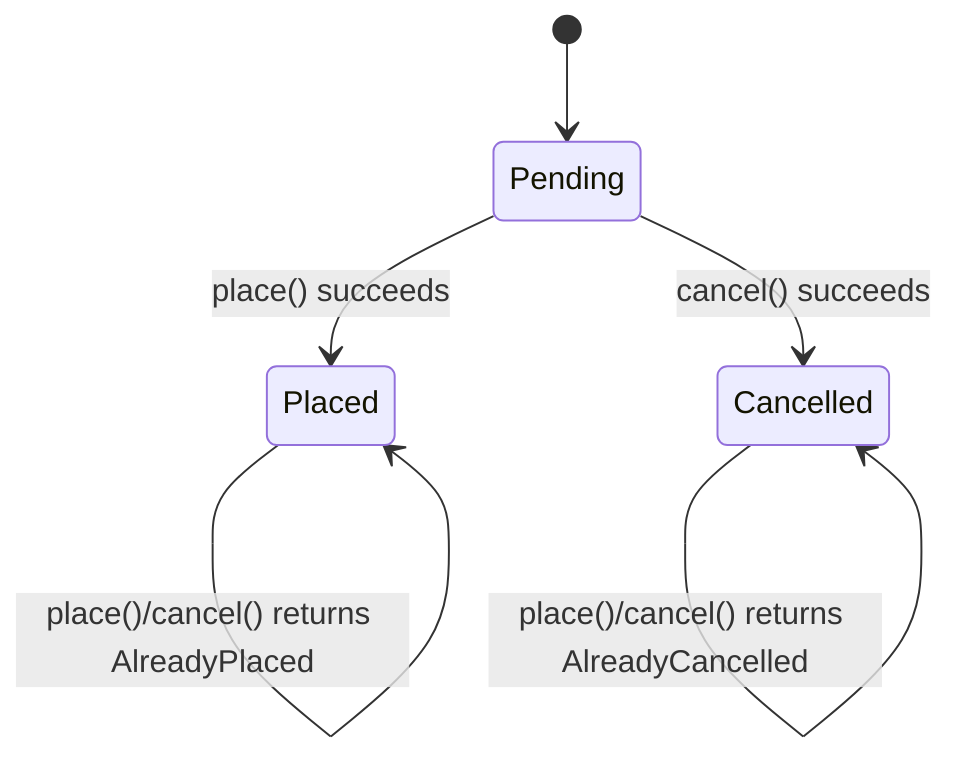

# Agent state views — what an `on call` handler does to an agent's state, not who it talks to

- **Status:** Settled, ready to slice. Spine issue
  [#2190](https://github.com/bynk-lang/bynk/issues/2190). This doc lands via the
  settling PR [#2191](https://github.com/bynk-lang/bynk/pull/2191), which
  references the spine (*"Part of #2190"*, never `Closes`). All seven
  questions in §3 are **settled**, each in the direction the draft leaned. The
  draft was tightened under review: reads after a write are pinned, and `?`
  edges over-approximate reachability soundly. §3.4's open fact (Mermaid
  `click` in state diagrams) was checked against Mermaid 12.2 itself. No
  slice proposal is open yet.
- **Realises:** the editor-tooling line of
  [`../bynk-lsp-spec.md`](../bynk-lsp-spec.md) §3.23 (sequence diagram) and the
  architecture-map section after it, extended to the one runtime participant
  those views describe least well. It also makes the hand-drawn
  `stateDiagram-v2` in the Book's
  [state-machine guide](../../site/src/content/docs/book/guides/agents-and-state/state-machine.md)
  mechanical.
- **Posture:** feature track per
  [ADR 0076](../decisions/0076-feature-track-posture.md), run GitHub-native per
  [ADR 0167](../decisions/0167-feature-tracks-run-github-native.md). It
  qualifies on two axes, multi-increment and an unsettled surface (§2).
- **What it does not do:** add language surface. The Book's agents reference
  says "Legal-transition tables are a later increment"
  (`book/reference/agents.md:103`). That increment stays out of scope. §3.7
  only asks what this track's model must look like so that increment can
  reuse it.
- **Governing records:**
  - [0258](../decisions/0258-sequence-diagram-lifeline-classifier.md)–[0275](../decisions/0275-sequence-diagram-principal-actor.md):
    the sequence diagram's lifelines, scope, branches and actor.
  - [0301](../decisions/0301-architecture-map-data-source.md): a model view
    re-parses the committed snapshots.
  - [0504](../decisions/0504-live-model-views.md): model views are live and
    client-pulled.
  - [0107](../decisions/0107-agent-invariant-predicate-surface.md): the
    `invariant` and `transition` predicate surface.
  - [0487](../decisions/0487-no-send-in-agent-handler.md): no `~>` in an agent
    handler.

## 1. The theme

The VS Code extension has two model views that fit services well. The
**architecture map** (ADR 0301) shows contexts, adapters and the edges between
them. The **sequence diagram** (ADRs 0258–0275) shows one handler's messages
across runtime boundaries. It answers *who does this handler talk to, and in
what order*.

For an agent's `on call` handler that is usually the wrong question. Most agent
handlers talk to nobody. What they do is move the agent from one state to the
next, and the sequence diagram can't see that:

- **State writes are dropped.** `walk_block` (`bynk-ide/src/sequence.rs:378`)
  walks the right-hand side of a `Statement::Assign` for nested control flow
  and emits nothing for the write itself. Store operations (`items.put(…)`,
  `count.update(…)`) are not lifelines under ADR 0258's classifier, so they
  fold into the activation and vanish too.
- **There is no actor.** An agent handler can't carry a `by` clause
  (`bynk.actor.by_on_agent`). The LSP passes no principal for agent handlers
  (`bynk-lsp/src/sequence_request.rs:54-62`). Replies therefore render as notes
  over the single entry lifeline (`branch_reply`, `sequence.rs:492`) rather
  than as the return arrows ADR 0275 gives a service.
- **The state machine is spread across handlers.** Each sequence diagram is
  scoped to one handler. `Order.place()` and `Order.cancel()` are each half of
  one machine, and no single-handler view can show it whole.

For the canonical `Order` example, the diagram is one lifeline, an
`alt Pending / Placed / Cancelled` box and three reply notes. The
`Pending → Placed` transition, the one fact that matters, never appears. The
state-machine guide draws the picture a reader actually wants by hand
(`state-machine.md:52-59`):

**End state when the track retires:**

- Every agent has a live **state view** in the extension, alongside the
  sequence diagram.
- For each state-carrying `Cell`, the view shows a state diagram generated from
  the handlers, and a handler × state table of outcomes.
- An edge that a declared `transition` would refuse at runtime is flagged in
  the view as you edit.
- The sequence diagram of an agent handler shows its state writes.
- The model behind the view has the shape a future declared transition table
  would be checked against (§3.7).

### 1.1 What is already true

The language leaves the machine implicit; the convention carries it:

- **The state.** A `store status: Cell[E] = Initial` field, where `E` is an
  `enum` or a sum, *is* the machine. ADR 0003's inline initialisers mean a
  sum-typed state starts in a named variant, not in `None`.
- **Reading and moving it.** `match status { … }` or `if status is X` reads the
  state; `status := X` moves it. `:=` is valid only against a `store Cell`
  (`bynk.cell.invalid_target`). Writes commit atomically when the handler
  returns. A fault persists nothing. A domain `Err(…)` is an ordinary value, so
  writes made before it **do** commit.
- **No restriction on moves.** Any `:=` to any value of the type checks
  (`agents.md:102-104`). A `transition` step invariant (an `old`/`new`
  predicate, ADR 0107) is the only constraint on moves, and it is checked at
  runtime, at commit (`InvariantViolation`).
- **Exhaustiveness.** `check_match` (`bynk-check/src/checker/expressions.rs`)
  guarantees every `match status` covers every state, and flags unreachable
  arms (ADR 0429).
- **Corpus.** The pattern is common in the compiler fixtures:
  `155_state_sum_machine`, `156_state_transition`, `159_order_lifecycle`,
  `222_agent_invariant`, `245_transition_step_invariant`,
  `1374_agent_invariant_transition_hoist`, `2018_history_transition_near_miss`,
  and others. None of the example projects under `examples/` uses it. Their
  agents (`Todos`, `Limiter`, the event log, sessions) hold maps, counters and
  logs instead.

What the tooling has to build on:

| Need | Exists today |
| --- | --- |
| The agent's store fields and handlers | `ContextSequenceInfo.agents: HashMap<String, AgentDecl>` (`bynk-check/src/analysis.rs:146`), already threaded to the LSP for the sequence diagram |
| An enum's or sum's variant list | `ContextBoundaryInfo.types: HashMap<String, Arc<TypeDecl>>` (`analysis.rs`, #855) |
| Which `is` tests hold on a branch | `bynk_check::narrowing::matched_is_tests` (`narrowing.rs:34`) |
| Match-arm labels | `pattern_summary` (`sequence.rs:699`) |
| A branch's reply summary | `branch_reply` (`sequence.rs:492`) |
| Live, cursor-following panels | The refresh hub and `LivePanel` (ADR 0504) |
| Resolved store operations (`Callee::Store`) | In the checker's `TypedCommons.callees` only. **Not** retained in `ProjectAnalysis` |
| A transition table, CFG or reachability analysis | **None** |

## 2. Why a track (the ADR 0076 trigger)

- **Multi-increment. Yes.** There are at least four increments, each useful
  alone (§4):
  - state writes in the sequence diagram;
  - the state model query;
  - the view;
  - the `transition` overlay.

  A per-handler effect summary for agents with no enum state is a possible
  fifth.
- **Surface not yet settled. Yes.** It is open what counts as "the state", what
  the extractor reads, and how the view is presented. It is also open whether
  a statically violable `transition` is only a view annotation or also a
  checker diagnostic, and how all of this relates to future transition tables
  (§3).
- **Security or safety boundary. No.** The view is editor-only and read-only
  over local source (§6).

## 3. Design questions

### 3.1 — What is "the state"? — SETTLED: user enum and sum `Cell`s, one diagram per field

**Question.**

- Which store fields get a state diagram?
- Does an agent with several such fields get one diagram per field, or one
  over the product of their states?
- What does an agent with none get?

**Settled.**

- **A state field** is a `store` `Cell` whose declared type is a user `enum`
  or a user sum type. Each variant is a state. A payload is abstracted to its
  constructor (`Square(_)`).
- **`Option[T]`, `Result[T, E]`, records and scalars are not state fields.**
  They hold values; they are not machines. `Cell[Option[Int]]`
  (`139_agent_state_zero_option`) is a slot, not a two-state lifecycle.
  Treating it as one would put a meaningless diagram on most agents.
- **One diagram per state field**, chosen with a selector when there are
  several. A product diagram grows multiplicatively and is rarely what an
  author meant. A write to field B under a match on field A still shows up as
  a guard on B's edge (§3.3).
- **An agent with no state field** gets an empty state view that says why and
  links to its handlers. The per-handler effect summary (§4, slice 4) is the
  real answer for those agents. It is the most-used shape in `examples/`.
  It stays in this track as the last slice, because it shares the panel, the
  lens and the path extractor of §3.3. It is the only slice not needed for
  the track's core end state, and it may be cut as a follow-on when slicing
  if slices 0–3 show the panel is the wrong home for it.

### 3.2 — Where the view lives — SETTLED: agent-scoped, its own live panel

**Question.**

- Is the view agent-scoped or handler-scoped?
- Is it a separate panel or a mode of the sequence panel?
- How does it fit ADR 0504's live, cursor-following model?

**Settled.**

- **Agent-scoped, in its own panel.** A state machine is a property of the
  agent, so a per-handler state view would repeat §1's third problem.
- **A `Show State` lens on the `agent` declaration.** The server already puts
  `Show Sequence` on every handler (ADR 0504); this adds one lens per agent.
  An editor title-bar button opens the same panel.
- **It follows the cursor at agent granularity.** Under ADR 0504 the panel
  retargets when the enclosing *agent* changes, not the handler. When the
  cursor is in a handler, that handler's row in the table and its edges in the
  diagram are highlighted. The panel can still be pinned, as today.
- **It does not share a panel with the sequence diagram.** The sequence view
  is handler-scoped and Mermaid `sequenceDiagram`-shaped; the state view is
  neither. A combined panel would complicate both refresh keys for no gain.

### 3.3 — What the extractor reads, and what it computes — SETTLED: a re-parse, no `ProjectAnalysis` change

**Question.**

- Does the model come from a syntactic re-parse, as ADR 0301 chose, or does it
  need the checker's resolved `Callee::Store` table retained in
  `ProjectAnalysis`?
- How are paths, guards and writes the extractor can't evaluate handled?

**Settled: a re-parse, with no `ProjectAnalysis` change.**

- **Cell writes are syntactic.** `:=` is a statement form, and
  `bynk.cell.invalid_target` already guarantees its target is a `store Cell`.
  Identifying a write to `status` needs no resolution.
- **Store operations are nearly syntactic too.** The state model needs exactly
  one: `Cell.update(f)` on a state field (`CELL_STORE_OPS`,
  `bynk-check/src/store_ops.rs:97`), which is a write to a `?` target (step 3
  below). Slices 0 and 4 need the rest. `AgentDecl.store_fields` gives each
  field's kind. A method call whose receiver is a bare store-field name, with
  a method in `store_ops.rs`'s registry for that kind, is a store operation.
  Shadowing by a local `let` is the only ambiguity, and the re-parse can see
  the binding.
- **Retaining `callees` for the LSP would be a real cost.** It would be the
  first `ExprId`-keyed checker table to cross into `ProjectAnalysis`. It
  should wait until a view needs something the AST cannot say. Record this as
  the front-loaded ADR (§5) in the way ADR 0301 recorded its own choice.

**What the extractor computes, per handler:**

1. **Paths.** It enumerates paths through the handler body's statement-level
   and tail control flow (`if`, `match`, blocks), the same scope the sequence
   diagram walks (ADR 0259). There is no depth cap, because a table has no
   layout problem; `MAX_BLOCK_DEPTH` is a diagram limit. A table does have a
   size problem, though. Enumerating paths one by one multiplies across
   sequential branches: *k* independent `if`s in a row give 2^*k* paths. The
   view is recomputed live (ADR 0504), so slice 1 does two things:
   - **It merges paths at each join point.** At the end of an `if` or
     `match`, paths that agree on the from-set, the current value and the
     last write are merged. Their opaque guards are kept as a set of
     labels. This makes the extractor a dataflow pass, not a path
     enumerator. The edges are the same, since an edge depends only on
     those three facts plus the outcome, and outcomes only diverge at the
     tail.
   - **It has a hard budget as a backstop.** If the number of distinct
     paths still exceeds a fixed limit (merging can't collapse paths that
     differ in from-set or write), extraction stops for that handler. Its
     row shows a single "too many paths" cell, linked to the handler, and
     its edges become `?` edges from every state. That keeps §3.4's
     reachability and §3.5's overlay sound.
2. **The pre-state set on each path.** It starts as all variants. Each step
   narrows it:
   - a `match <field>` arm narrows to the arm's constructors;
   - an arm guard, or an `if` condition, narrows by `matched_is_tests`;
   - any other condition is kept as an **opaque guard**, labelled with its
     source text (`[quantity > 0]`).

   **A read after a write sees the write.** A bare-name read returns the
   staged value. The agents reference says of `update`, "read the bare name
   back to observe it", and ADR 0125 D4 lowers it to a staged
   read-modify-write. So the extractor tracks two things per path: the
   from-set and the field's *current* value.

   - Before the first write, a test on the field narrows the from-set, as
     above.
   - After a write of a known variant `X`, a test on the field is decided
     statically. Arms and branches inconsistent with `X` are infeasible on
     that path and are pruned. The from-set is untouched.
   - After a `?` write, a test on the field narrows neither. It is kept as
     an opaque guard on the path.
3. **The write on each path.** The *last* `:=` to the field on the path wins,
   because writes commit together at return. The target is classified as:
   - **a known state**, for a variant literal;
   - **`?`**, for a computed value, a call, or `field.update(f)`;
   - **unchanged**, when there is no write.
4. **The outcome on each path.** This is `branch_reply`'s summary of the tail
   (`Ok`, `Err(AlreadyPlaced)`). A path that faults (an `expect`, a `<-` on a
   failing effect) persists nothing and contributes **no edge**. A domain
   `Err` with a preceding write **does** contribute one. That is exactly the
   case the table is best at exposing, since nothing in the source signals it.

The edge record is `(from: set of states, handler, guards, to: state | ? |
unchanged, outcome, span)`. The span is the write's span, or for an
unchanged path the tail's, which gives click-to-code.

**Unconditional writes.** A handler that writes without reading the state
(`Turnstile.unlock`: `gate := Unlocked`) produces a from-set of *all*
variants. That is correct, and it is the case §3.5 most needs: an unguarded
write is a transition from every state, including a terminal one.

### 3.4 — Presentation — SETTLED: both, with the table as the exact one

**Question.**

- A Mermaid `stateDiagram-v2`, a handler × state table, or both?
- Where do refused calls (outcome, no state change) go?
- How does click-to-code work?

**Settled: both, with the table as the exact one.**

- **The table.** Rows are handlers, columns are states, cells are outcomes
  (`→ Placed · Ok`, `Err(AlreadyPlaced)`, `? · Ok`). A cell with several paths
  lists each with its guard. The table is total by construction: every
  handler × state pair has a cell. A gap in the author's intent therefore
  shows as an odd cell, not as a missing arrow. For the `Order` example:

  | | Pending | Placed | Cancelled |
  | --- | --- | --- | --- |
  | `place()` | → Placed · `Ok` | `Err(AlreadyPlaced)` | `Err(AlreadyCancelled)` |
  | `cancel()` | → Cancelled · `Ok` | `Err(AlreadyPlaced)` | `Err(AlreadyCancelled)` |

- **The diagram.** It shows state-changing edges only, plus `[*] →
  <initialiser>`. Refused calls are self-loops, which the guide draws but
  which clutter any machine larger than three states. They stay in the table
  behind a "show unchanged" toggle in the diagram. Edges between the same pair
  of states are merged into one, with the handler labels joined. A `?` target
  renders as a dashed edge to a `?` pseudo-state.
- **States no edge reaches from the initialiser** are drawn dimmed, because
  an author usually wants to know that. Reachability is computed with every
  `?` edge treated as an edge *to every state*. That is a sound
  over-approximation of the reachable set. A state is dimmed only when even
  this over-approximation can't reach it, so a dimmed state is truly
  unreachable from the handlers. `?` edges make dimming rarer, never wrong.
  (Ignoring `?` edges instead would under-approximate, and could dim a state
  a computed write actually reaches.)
- **Click-to-code.**
  - Table cells link to their spans directly; they are plain HTML.
  - **The diagram does not use Mermaid's `click`.** Checked against
    `mermaid@12.2.0`'s own `stateDiagram-v2` chunk: it parses
    `click <state> "<url>" "<tooltip>"`, but only as a URL link. It wraps the
    state's node in an `<a target="_blank">`, with no callback form, and has
    no link on transitions at all. That is wrong for a webview, which must
    post a message to the extension, not navigate.
  - **The webview maps the SVG back to the model.** This is the approach the
    sequence view already uses (`participant-map.ts`). State nodes are easy:
    Mermaid gives each a deterministic DOM id, `state-<id>-<n>`
    (`stateDomId`), so a state maps by id. Transition labels map in emission
    order, as the sequence view's messages do (`messageOrder`).
- **Generation stays client-side.** The Rust model is Mermaid-agnostic, as
  `bynk-lsp-spec.md` §3.23 requires. A new `state-gen.ts` sits beside
  `mermaid-gen.ts` and `architecture-gen.ts`.

### 3.5 — The `transition` overlay — SETTLED: a view annotation over a closed fragment

**Question.**

- Which `transition` predicate shapes can be evaluated against a derived
  edge?
- Is a violating edge only drawn in the view, or also reported as a checker
  warning?

**Settled.**

- **Evaluate a small, closed predicate fragment over one state field:**
  - `old.f is X` and `new.f is X`, and the same with `==` against a variant
    literal;
  - `!`, `&&`, `||` and `implies` over those, with parentheses.

  An edge `S → T` in handler `h` *violates* predicate `p` when `p` is false
  for `old.f = S, new.f = T`. A predicate that mentions anything else (another
  field, a payload, a function call, an `if`) is listed as **not evaluated**,
  never guessed.

  **Corpus check.** The fragment covers every `transition` over a state field
  in the fixtures: `245_transition_step_invariant`, the `2018_history_*`
  fixtures, and `1649_agent_state_round_trip`'s `old.light == Red ||
  old.light == Green`. There is one exception. `1374_agent_invariant_transition_hoist`'s
  `if old.status == old.status { … } else { false }` is a hoisting test, not a
  state constraint, and lands in "not evaluated". The many `transition`s over
  numeric fields (`new.count >= old.count`) constrain no state field, so the
  overlay ignores them.

- **Unchanged paths are `S → S`.** A `transition` is checked at commit whether
  or not the field was written (`agent-invariants.md`). So a path that leaves
  the field unchanged is evaluated as `old.f = S, new.f = S`. Take
  `transition must_advance: old.status is Pending implies new.status is
  Placed`: a refused call from `Pending` violates it without writing
  anything. A violating unchanged path is flagged in its table cell. In the
  diagram, its self-loop is always drawn, in red, even while §3.4's "show
  unchanged" toggle is off. A flagged edge is never hidden.
- **`?` targets are checked against every state they could reach.** For a `?`
  edge from `S`, `p` is evaluated for each possible `T`:
  - every `T` violates `p`: the edge is drawn red, as a known violation;
  - some `T` do, but not all: the edge is drawn amber, as **may violate**,
    and the violating targets are listed in its cell;
  - no `T` does: the edge is not flagged.

  This never misses a target that violates `p`. Amber marks a possible
  violation rather than claiming a definite one.
- **Example: fixture 245.** `transition paid_is_terminal: old.status is Paid
  implies new.status is Paid`, together with an unguarded
  `place() { status := Placed … }`, gives the edge `Paid → Placed`. The view
  draws it red, with the predicate's name and a link to it. At runtime that
  call fails with `InvariantViolation`, and today nothing says so before then.
- **Edges from unreachable states are not flagged.** An edge from a state the
  agent can never reach is noise. "Unreachable" uses §3.4's
  over-approximation, with `?` edges going to every state. A `?` edge
  therefore only widens the set of states whose edges are checked. It never
  switches the overlay off. Fixture 245's `Paid → Placed` is flagged whether
  or not some other handler makes a computed write.
- **View annotation first. A checker diagnostic is a separate decision.** A
  warning (`bynk.transition.may_violate`) would reach the Problems panel and
  `bynkc check`, which is more useful. But it is a checker rule with its own
  soundness obligations: guards the extractor treats as opaque, `?` targets,
  and refactors that change the reachable set. It also needs fixtures and an
  ADR. So slice 3 ships the overlay only. The diagnostic is not part of this
  track. It may be cut as its own increment proposal once the overlay has
  shown how often it would fire falsely.

### 3.6 — State writes in the sequence diagram — SETTLED: notes, not a lifeline

**Question.** Should the sequence diagram of an agent handler show state
writes and store operations, and in what form?

**Settled: yes, as notes, not as a lifeline.**

- ADR 0258 keeps lifelines to *runtime boundaries*: a capability, another
  context, another agent. An agent's own store is the Durable Object's own
  storage, not a boundary, so a "store" lifeline would bend that rule for
  presentation's sake.
- **A note on the entry lifeline, in branch order, inside the enclosing alt
  block:** `status := Placed`, `items.put(id, …)`. This fits the existing
  model, as a new `Message` kind or a new note list beside `Branch.reply`. It
  also fits `mermaid-gen.ts`'s note handling and its `noteOrder`
  click-mapping.
- **Agent handlers only.** Services have no store. A service's own
  `Cache`/`Kv` capability calls are already lifelines.
- **It ships before the state view.** It is the smallest change that fixes the
  complaint as reported, and is useful even if the rest of the track
  re-scopes.

### 3.7 — Future declared transition tables — SETTLED: a constraint on the model's shape only

**Question.** This track builds no language surface. Should the derived model
nevertheless be shaped as the thing a future declared transition table is
checked against?

**Settled: yes, as a constraint on the model's shape only.**

- §3.3's edge record (`from set × handler × guards → target`) is the natural
  denotation of a declared table. A future checker rule would compare the
  declared relation with the derived one, and a derived edge outside the
  declared relation is the error.
- If the model keeps that shape, the future increment reuses the extractor in
  `bynk-check` rather than writing a second one. That means moving the pure
  extraction function below `bynk-ide`, which is why §3.3 keeps it a
  dependency-free function of `AgentDecl` and the type table.
- **Nothing is built for this, and nothing is promised about table syntax.**
  The track doc records the constraint. The language increment remains its
  own proposal, with its own surface review.
- A useful by-product: the view gives real data on what such tables would
  need to express (guards, `?` targets, from-all edges) before any syntax is
  chosen.

## 4. Candidate slice decomposition

Settled with §3. Slices 0 and 1 are independent; 2 needs 1, 3 needs 2, and
4 needs 1 and 2. Each slice is cut as an increment proposal, a sub-issue of
the spine.

0. **State writes in the sequence diagram** (§3.6). Notes for `:=` and store
   operations in agent handlers. `SequenceModel` gains the note kind; the wire
   type and `mermaid-gen.ts` follow. Add the first test that builds a model
   for an agent's *own* `on call` handler. Today there is none
   (`sequence.rs` tests and `bynk-lsp/tests/sequence_request.rs` exercise only
   a service calling an agent).
1. **The `agent_state_model` query** (§3.1, §3.3). A pure function in
   `bynk-ide/src/agent_state.rs` from an `AgentDecl` and the type table to
   `AgentStateModel { fields: [StateMachine { field, states, initial, edges,
   reachable }] }`. It is unit-tested against `155`, `156`, `159`, `245` and
   `2018_history_transition_near_miss`. It also gets two new fixtures: one for
   the "`Err` after a write" case, and one for a read of the state field after
   a write on the same path (§3.3 step 2).
2. **The state view** (§3.2, §3.4). A `bynk/agentStateModel` request, the
   `Show State` lens, a live panel showing the diagram and the table with
   click-to-code, and coverage in the extension's integration suite.
3. **The `transition` overlay** (§3.5). Predicate evaluation over the
   fragment, red edges, and a "not evaluated" list. The diagnostic, if
   wanted, is a follow-on proposal.
4. **A per-handler effect summary** for agents with no state field (§3.1):
   - for each path, its guards, the fields it writes or touches, its agent
     calls, and its reply;
   - the last slice, and the one that may be cut as a follow-on when slicing
     (§3.1).

## 5. Front-loaded ADR candidates

- **The state model's data source.** A re-parse of the committed snapshots,
  not retained checker callees (§3.3). This is the analogue of ADR 0301, and
  it fixes where the extraction function lives so §3.7 stays open.
- **State writes are notes, not lifelines** (§3.6). It amends nothing in
  ADR 0258 but records why the store isn't a boundary.
- **A statically violable `transition` is a view annotation.** A diagnostic
  is a separate, later decision (§3.5).

## 6. Threat model

None. The view reads the last committed analysis round's snapshots of local
source, as every model view does (ADRs 0301, 0504). It renders in a webview
under the extension's existing content security policy with the vendored
Mermaid. It writes nothing, calls nothing and sends nothing off the machine.

## 7. Slice status

- [ ] Slice 0: state writes in the sequence diagram
- [ ] Slice 1: `agent_state_model` query
- [ ] Slice 2: the state view
- [ ] Slice 3: `transition` overlay
- [ ] Slice 4: per-handler effect summary

## 8. Done when

- An agent handler's sequence diagram shows its state writes and store
  operations.
- Every agent with a state field has a live state view, with a generated
  diagram and a total handler × state table, both linking to source.
- The guide's hand-drawn `Order` diagram could be replaced by the generated
  one without losing information.
- An unguarded write that a `transition` forbids from a reachable state shows
  as a red edge before the code is run.
- The extraction function's shape and placement leave the future transition
  table increment free to reuse it (§3.7).
