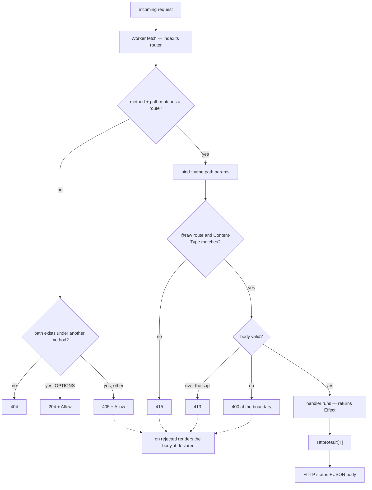

HTTP handlers are declared in a `service` inside a `context`. See the
[grammar for HTTP handlers](/book/reference/grammar/#rule-http_handler) for the production
and the diagnostics that govern it.

## Handler form

```bynk,ignore
service <Name> from http {
  on <METHOD>("<route>") (<params>) -> Effect[HttpResult[T]] {
    …
  }
}
```

- **Methods:** `GET`, `POST`, `PUT`, `PATCH`, `DELETE`.
- **Route:** must start with `/`; a `:name` segment is a path parameter.
- **Parameters:** each parameter is a path parameter (matching a `:name`
  segment), the special `body` parameter, or the special
  [`headers`](#request-headers) parameter. A path parameter's type must be
  constructible from a string (`bynk.http.path_param_not_stringy`); `GET` and
  `DELETE` may not take a `body` (`bynk.http.body_on_get_or_delete`).
- **Return type:** must be `Effect[HttpResult[T]]`
  (`bynk.http.return_not_effect_http_result`).

> [!DANGER]
> The `/_bynk/` route prefix is reserved for the runtime. Any route under it is
> rejected with `bynk.http.reserved_prefix`.

A `body` parameter is parsed from the request JSON and validated before the
handler runs; an invalid body is rejected with `400` at the boundary — unless the
handler is [`@raw`](#raw-request-bodies), which takes the request's octets as
`Bytes` instead.

## Request headers

A handler that needs the request's headers declares a `headers: RequestHeaders`
parameter. It may sit anywhere among the parameters; the router passes the
request's own headers. `RequestHeaders` is a read-only view with three methods:

| Method | Returns | Reads |
|---|---|---|
| `get(name)` | `Option[String]` | any header, by case-insensitive name |
| `bearer()` | `Option[String]` | the token of an `Authorization: Bearer <token>` header |
| `clientIp()` | `Option[String]` | the platform's `CF-Connecting-IP` (see below) |

```bynk,fragment
on GET("/whoami") (headers: RequestHeaders) -> Effect[HttpResult[String]] by v: Visitor {
  match headers.bearer() {
    Some(token) => Ok("token \(token)")
    None => Unauthorized
  }
}
```

`clientIp()` reads `CF-Connecting-IP`, which Cloudflare's edge sets on every
request, overwriting any value the client sent. It is the client's address
only behind that edge: under `bynk dev`, in tests, or on any other host, the
caller sets the header, so don't rate-limit or audit by it there.

This is how a service implements an existing API's authentication scheme, one an
[actor](/book/reference/actors/) does not describe. Where an actor fits, prefer
it: the seam verifies the credential before the handler runs.

The view is read while the request is handled, never kept: `RequestHeaders` can't
be a field of a type or cross a boundary (a call, a message, an agent), though a
plain function may take it to share a check between handlers
(`bynk.types.headers_at_boundary`). A parameter named `headers` must have this
type (`bynk.http.headers_wrong_type`). A test builds one with
[`RequestHeaders.of`](/book/reference/testing/#request-headers).

## `HttpResult` variants

The vocabulary tracks the common, modern HTTP status codes (RFC 9110). A
variant's payload is one of seven shapes: the value `T` as JSON (`Value`), a
target URL emitted as a `Location` header (`Location`), an explanatory
`message` as an `{ "error": … }` JSON body (`Message`), a `Stream[String]`
emitted as an SSE (`text/event-stream`) body (`Streamed`), a raw
`Bytes` body under an author-declared `content-type` (`Raw`, and `RawCreated` at
`201`), the same with the entity tag its `ETag` carries (`RawTagged`), a
`Stream[Bytes]` body streamed chunk by chunk (`RawStreamed`), or no body at all
(`None`).

### 2xx success

| Variant | Status | Payload |
|---|---|---|
| `Ok(value)` | 200 | the value, as JSON |
| `Streaming(stream)` | 200 | a `Stream[String]`, SSE-framed (see [Streamed responses](#streamed-responses)) |
| `Raw(body, contentType)` | 200 | a `Bytes` body under the given `content-type` (see [Raw responses](#raw-responses)) |
| `RawTagged(body, contentType, etag)` | 200 | as `Raw`, sent with `etag` as its `ETag` (see [Supplying the validator](#supplying-the-validator-rawtagged)) |
| `RawStreamed(body, contentType)` | 200 | a `Stream[Bytes]` body, streamed chunk by chunk (see [Streamed raw responses](#streamed-raw-responses)) |
| `RawCreated(body, contentType)` | 201 | as `Raw` (see [Raw responses](#raw-responses)) |
| `Created(value)` | 201 | the value, as JSON |
| `Accepted(value)` | 202 | the value, as JSON |
| `NoContent` | 204 | none |

### 3xx redirection

A redirect carries the target URL, emitted as a `Location` header with an empty
body.

| Variant | Status | Payload |
|---|---|---|
| `MovedPermanently(url)` | 301 | `Location` header |
| `Found(url)` | 302 | `Location` header |
| `SeeOther(url)` | 303 | `Location` header |
| `TemporaryRedirect(url)` | 307 | `Location` header |
| `PermanentRedirect(url)` | 308 | `Location` header |

### 4xx client error

| Variant | Status | Payload |
|---|---|---|
| `BadRequest(message)` | 400 | message |
| `Unauthorized` | 401 | none |
| `Forbidden` | 403 | none |
| `NotFound` | 404 | none |
| `MethodNotAllowed` | 405 | none |
| `NotAcceptable` | 406 | none |
| `RequestTimeout` | 408 | none |
| `Conflict(message)` | 409 | message |
| `Gone` | 410 | none |
| `LengthRequired` | 411 | none |
| `PayloadTooLarge(message)` | 413 | message |
| `UnsupportedMediaType(message)` | 415 | message |
| `UnprocessableEntity(message)` | 422 | message |
| `TooManyRequests(message)` | 429 | message |
| `UnavailableForLegalReasons(message)` | 451 | message |

### 5xx server error

| Variant | Status | Payload |
|---|---|---|
| `ServerError(message)` | 500 | message |
| `NotImplemented(message)` | 501 | message |
| `BadGateway(message)` | 502 | message |
| `ServiceUnavailable(message)` | 503 | message |
| `GatewayTimeout(message)` | 504 | message |

> [!TIP]
> A bare `Ok(…)` builds whatever the expected type says (a `let` annotation, a
> match arm, an argument) and otherwise follows the handler's return type. So in a
> handler returning `HttpResult[_]`, `let r: Result[Int, String] = Ok(1)` is a
> `Result`. Qualify it (`Result.Ok(…)`, `HttpResult.Ok(…)`) to choose explicitly
> (#1659).

## Error bodies

The error variants answer with Bynk's own body: `{ "error": message }`, or no body
at all. A service that implements an existing API's contract needs that API's error
shape instead. `RawError(status, body, contentType)` answers an error status with a
[`Bytes`](/book/reference/types/#bytes) body you choose, under the content type you
give, and runs no codec, just as [`Raw`](#raw-responses) does for a `200`:

```bynk,fragment
fn problem(code: String, message: String) -> Bytes {
  Bytes.fromUtf8("{\"error\":\"\(code)\",\"message\":\"\(message)\"}")
}
```

```bynk,fragment
on PUT("/packages/:name") (name: String, body: String) -> Effect[HttpResult[()]] by v: Visitor {
  RawError(Conflict, problem("conflict", "\(name) already exists"), "application/json")
}
```

The status is an `ErrorStatus`: the name of one of the 4xx or 5xx variants in the
tables above (`Forbidden`, `Conflict`, `ServiceUnavailable`, …), bare or qualified
(`ErrorStatus.Forbidden`). Only those names are accepted, so a `RawError` can't
answer a 2xx or 3xx (`bynk.http.raw_error_status`). The status is fixed where the
response is built: `ErrorStatus` is not a type, so a helper takes the parts of the
body and the handler names the status (`bynk.http.error_status_position`).

A test matches a `RawError` by its number: `expect r is RawError(409, _, _)`. A
system-tier test decodes the response by its status, as it does for every
variant, so there the same response reads as `Conflict(_)`.

## Rendering rejections

The router refuses some requests before any handler runs: a `400` for a body or
path parameter that fails to parse or validate, a `405` for a method the path
doesn't declare, a `413` for a body over its cap, a `415` for a `@raw` route's
other content type, and a `401` from a `Signature` seam. Each answers in Bynk's own
shape, `{ "kind": …, "details": … }` or no body. A service whose contract says
otherwise renders them itself with `on rejected`:

```bynk,fragment
on rejected(why: BoundaryRejection) -> Effect[HttpResult[()]] {
  match why {
    PayloadTooLarge(_) => RawError(PayloadTooLarge, problem("too_large", "the body is too large"), "application/json")
    MethodNotAllowed => RawError(MethodNotAllowed, problem("method", "no such method"), "application/json")
    _ => RawError(BadRequest, problem("bad_request", "the request is malformed"), "application/json")
  }
}
```

`why` is the rejection: `MalformedJson(detail)`, `StructuralMismatch(detail)`,
`RefinementViolation(detail)`, `PayloadTooLarge(detail)`,
`UnsupportedMediaType(detail)`, `MethodNotAllowed` or `Unauthorized`.

The status is the rejection's own. The handler supplies the body, so it answers a
`RawError` of that status; the router keeps its other headers (the `Allow` of a
`405`) and stamps the service's CORS and security headers as usual. Any other
answer, another status or a fault in the handler sends the router's default
response instead, and logs why. A service without `on rejected` is unchanged.

The hook renders the rejections of its own service's routes. A `405` belongs to
a path rather than a route, so when two `from http` services in one context share
a path, the path's `405` uses the hook of the service declared first, just as its
CORS and security headers do. A service with `on rejected` and no routes
compiles; its hook is never called.

A service has at most one (`bynk.http.duplicate_rejected`). It takes exactly the
`BoundaryRejection` and returns `HttpResult[()]`, and it has no `by` (it runs before
any actor is known) and no `given` (`bynk.http.rejected_signature`). The `401`s an
actor's Bearer or OIDC seam returns, and the body refusals of a route whose `by`
is a sum of actors, are not rendered through it yet.

## Lifting an `Option` with `?` (v0.153)

Inside a handler returning `HttpResult[T]` (or `Effect[HttpResult[T]]`), the `?`
operator lifts an `Option`: `Some(v)` yields `v`, and `None` **early-returns
`NotFound` (404)**. This collapses the outer half of the ubiquitous read →
respond pyramid — a lookup that misses becomes a 404 without a `match`:

```bynk,fragment
on GET("/links/:code") (code: Slug) -> Effect[HttpResult[String]] by v: Visitor given Kv {
  let stored <- Kv.get(code.value)   // stored : Option[String]
  let raw = stored?                  // None → 404 NotFound; Some(s) → s
  Ok(raw)
}
```

`?` on an `Option` is accepted **only** where the enclosing return is an
`HttpResult` — elsewhere an `Option` has no error channel, and the checker
rejects it with `bynk.types.question_option_outside_http` (use `.okOr(err)` to
turn an `Option` into a `Result` in a `Result`-returning function). A `Result`
under `?` is unchanged: its `Err` propagates as before. Mapping a **domain
error** into an `HttpResult` — the `Result → HttpResult` direction — is a
separate, later capability; `?` does not yet convert an arbitrary `Err` into a
status.

## Method semantics

The methods a path answers are **derived from the routes you declare** — there is
nothing to write. For a service declaring `POST /links` and `GET /links/:code`,
the router synthesises, from that table alone:

| Request | Answer |
|---|---|
| `GET /links` (a live path, wrong method) | `405` with `Allow: OPTIONS, POST` |
| `OPTIONS /links` (a plain, non-preflight `OPTIONS`) | `204` with `Allow: OPTIONS, POST` |
| `HEAD /links/:code` | the `GET` status and headers, with an empty body |
| `OPTIONS /links/:code` | `204` with `Allow: GET, HEAD, OPTIONS` |
| `DELETE /links/:code` (wrong method) | `405` with `Allow: GET, HEAD, OPTIONS` |
| `GET /nope` (no such path) | `404` — unchanged |

The **allowed-method set** for a path is the union of the methods declared on it,
plus `OPTIONS` always, plus `HEAD` whenever `GET` is present. So:

- **`405 + Allow`** — a request to a *live* path with an undeclared method is a
  `405` (not a `404`), carrying the derived `Allow` header (RFC 9110 §15.5.6). A
  request to a path that does not exist is still a `404`.
- **`OPTIONS`** — a plain (non-preflight) `OPTIONS` to a known path is a `204`
  carrying `Allow`. (A CORS preflight — an `OPTIONS` bearing
  `Access-Control-Request-Method` — is answered by the [CORS](#cors) machinery
  instead, with the `Access-Control-*` grant.)
- **`HEAD`** — a `HEAD` to a `GET` route runs the `GET` handler and returns its
  status and headers with an empty body (RFC 9110 §9.3.2). Because the handler
  runs, the headers are exactly a `GET`'s; a `Streaming` `GET` answered as `HEAD`
  returns the stream's headers without draining it. `content-length` is omitted
  (the body is never materialised — permitted).

`HEAD` and `OPTIONS` are **not** declarable methods — there is no `on HEAD`/`on
OPTIONS` to write; they are synthesised. This is a router correctness property
with no configuration and no "off": every `from http` service answers its method
contract. The `405`/`OPTIONS` answers are produced **before** the `by`/Bearer
auth seam (method discovery and method rejection are credential-less); a `HEAD`
runs the `GET` handler and so runs `GET`'s auth seam unchanged.

> [!NOTE]
> The synthesised `405` is a **router** response and always carries `Allow`. The
> author-returnable `MethodNotAllowed` variant (the table above) is a distinct,
> deliberate deny an author writes from a handler; it stays bodyless with no
> `Allow` header.

## Caching

A `GET` response splits into two halves — a **validator** (has this changed?) and
a **freshness window** (is stale data acceptable, and for how long?). The validator
is derivable from the bytes the handler already produces, so the compiler
synthesises it; the freshness window is a judgement only you can make, so you
declare it. Nothing else.

### Automatic revalidation (`ETag` / `304`)

Every **eligible `GET`** — one returning the JSON `Ok` variant, or a `Raw` body of
at most **1 MiB** — carries a synthesised weak
[`ETag`](https://developer.mozilla.org/en-US/docs/Web/HTTP/Headers/ETag) over its
body (the serialised JSON, or the raw bytes). When a client re-requests with a matching
`If-None-Match`, the router answers **`304 Not Modified`** with an empty body,
saving the transfer. This is on by default, with nothing to write:

| Request | Answer |
|---|---|
| `GET /links/:code` (first call) | `200` + body + `ETag: W/"…"` |
| `GET /links/:code`, `If-None-Match: W/"…"` (unchanged) | **`304`**, empty body, same `ETag` |
| `GET /links/:code`, a stale `If-None-Match` | `200` + body + the new `ETag` |

Only `Ok` and a small `Raw` are eligible. `Streaming`, redirects, and error
variants carry no `ETag` and are never answered `304` (a stream has no hashable
body; the rest have no representation to validate). A `Raw` body over 1 MiB
carries none either: hashing runs on every request, in proportion to the body,
and above that size it would spend the Worker's CPU budget — return
[`RawTagged`](#supplying-the-validator-rawtagged) to give a large body a validator.
The validator is **weak**
(`W/"…"`): it asserts *semantic* equivalence of the representation, which is what
revalidation needs. Because it is a content hash, a `304` still runs the handler
and serialises the body — it saves **bandwidth, not server work**. A cheaper
validator that short-circuits before the handler (e.g. a `Last-Modified` from a
store timestamp) is a planned follow-on.

### Supplying the validator (`RawTagged`)

When the handler already has a validator — a content hash in the key, an object
store's `etag`, a version number — return `RawTagged(body, contentType, etag)`
instead of `Raw`. The `etag` is sent as the response's `ETag` exactly as given,
with no hashing whatever the body's size, and a matching `If-None-Match` is
answered `304` through the same router step:

```bynk,ignore
@cache(maxAge: 365.days, scope: public, immutable: true)
on GET("/dl/sha256/:hex") (hex: String) -> Effect[HttpResult[()]] by v: Visitor given Store {
  match Store.get("dl/sha256/\(hex)") {
    Some(body) => RawTagged(body, "application/vnd.bynk.tree-v1", "\"sha256-\(hex)\"")
    None       => NotFound
  }
}
```

The `etag` is an entity tag as [RFC 9110 §8.8.3](https://www.rfc-editor.org/rfc/rfc9110#section-8.8.3)
writes it: double-quoted, optionally `W/`-prefixed (`"v1"`, `W/"v1"`), with
printable ASCII inside and no `"`. Leaving the `W/` off makes it a **strong**
validator. It is checked when the response is built: a malformed tag (`v1`,
unquoted) is never sent as a broken header — the handler's request faults, the
client gets a `500`, and the Worker logs the route (`files GET /dl/sha256/:hex
faulted`) with the reason. `RawTagged` sends its `ETag` on any method; only a
`GET` is answered `304`.

The `304` is a **router** response synthesised from the request, not an
`HttpResult` variant — there is no `NotModified` to return. Like the CORS
preflight, it is stamped with `Access-Control-Allow-Origin` for a CORS service, so
a cross-origin revalidation stays readable by the browser.

### Declared freshness (`@cache`)

To let a client or CDN serve a response **without revalidating** for a window,
annotate the handler with `@cache`, written immediately before `on GET`:

```bynk,ignore
service links from http {
  @cache(maxAge: 5.minutes)
  on GET("/links/:code") (code: Slug) -> Effect[HttpResult[Url]] by v: Visitor given Kv { … }
}
```

This emits `Cache-Control: private, max-age=300` alongside the automatic `ETag`.
`@cache` is the **first handler-position annotation**; it is legal only on a `GET`
handler, and applies to a response that is `Ok`, `Raw` or `RawTagged`. It is
ignored on `Streaming` and on errors.

| Field | Meaning | Default |
|---|---|---|
| `maxAge` | The freshness window, as a whole-second [`Duration`](/book/reference/types/#duration) — emitted as `Cache-Control: max-age` in whole seconds. **Required.** | — |
| `scope` | `public` or `private`. `private` lets only a client's own cache store the response; `public` also lets a **shared** cache / CDN store it. | `private` |
| `immutable` | `true` appends the [`immutable`](https://www.rfc-editor.org/rfc/rfc8246) directive (`Cache-Control: public, max-age=31536000, immutable`): browsers and CDNs do not revalidate within `maxAge`. | `false` |

`immutable: true` is **your promise** that the representation at this URL never
changes — true of a content-addressed path, whose URL changes whenever its
content does. A wrong promise means clients and CDNs serve the stale response
until `maxAge` runs out, with no revalidation to correct them. A value that is
not `true` or `false` is `bynk.http.cache_bad_immutable`.

The `private` default is the safe one: a shared cache never stores a response
unless you opt into `public`. A `GET` with no `@cache` still carries its `ETag`
(so it is revalidatable) but emits no `Cache-Control`. Duration units are plural —
`5.minutes`, `1.hours`, `30.seconds` — so a singular `1.hour` is a
`bynk.http.cache_bad_max_age` diagnostic; a value with a fractional-second
remainder (`500.milliseconds`, or `1500.milliseconds`, which is not a whole
number of seconds even though it is over one) is
`bynk.http.cache_max_age_fractional_seconds` — `Cache-Control: max-age` has no
finer granularity, so the remainder would otherwise be silently dropped rather
than honoured; `@cache` on a non-`GET` (or streaming) handler is
`bynk.http.cache_on_non_get`.

`@cache` only sets the header. Cloudflare does not store a response a Worker
generates because of its `Cache-Control`, so on its own `@cache` is honoured by
browsers and other caches downstream, not by Cloudflare's edge. To cache at the
edge, declare an [`EdgeCache`](/book/reference/bynk-capabilities/#edge-caching-edgecache)
instance in the context. Its Worker then keeps a `@cache` route's `2xx` at the
edge, sends `no-store` on every other `GET` or `HEAD` answer (a `404` included),
and can purge what it cached. That is the purge path an `immutable` response
needs if it can ever change, as a takedown changes it.

## Streamed responses

`Streaming(stream)` returns a **200** whose body is a [`Stream[String]`](/book/reference/types/#stream),
emitted as Server-Sent Events (`content-type: text/event-stream`). Each stream
element becomes one SSE event — `data: <element>\n\n` — so a handler can send an
incremental feed without buffering the whole response:

```bynk,fragment
on GET("/ticks") () -> Effect[HttpResult[()]] by v: Visitor {
  Streaming(Stream.of(["tick-1", "tick-2", "tick-3"]).take(3))
}
```

A streamed handler returns `Effect[HttpResult[()]]` — the JSON body parameter
`T` is unused, since the body is the stream. **A response commits its status and
headers before the first chunk**, so streaming is **200-only**: handle a
pre-stream failure by returning an ordinary variant *instead* of `Streaming`
(`NotFound`, `Unauthorized(…)`, …), which share `HttpResult[()]` and so sit in
the same handler with no type conflict:

```bynk,fragment
on GET("/feed/:mode") (mode: String) -> Effect[HttpResult[()]] by v: Visitor {
  if mode == "live" {
    Streaming(Stream.of(events).take(100))
  } else {
    NotFound
  }
}
```

## Raw responses

`Raw(body, contentType)` returns a **200** whose body is a raw
[`Bytes`](/book/reference/types/#bytes), written straight into the response under
the `content-type` you give — **no codec runs**. This is the service-tier escape
hatch for non-JSON bodies: `robots.txt`, `sitemap.xml`, `.well-known` documents,
RSS/Atom feeds, a CSV download, a QR-code PNG. Bynk serves *bytes with a
content-type*; it does **not** template HTML (that is the frontend tier).

`Bytes` is binary-first, so a PNG flows in directly and text goes through
`Bytes.fromUtf8` — which makes the UTF-8 charset an explicit author decision
rather than a runtime guess:

```bynk,fragment
on GET("/sitemap.xml") () -> Effect[HttpResult[()]] by v: Visitor {
  let xml = "<?xml version=\"1.0\"?><urlset></urlset>"
  Raw(Bytes.fromUtf8(xml), "application/xml")
}
```

Like `Streaming`, `Raw` returns `Effect[HttpResult[()]]` — the JSON body
parameter `T` is unused — and is **200-only**: it serves service-tier bodies,
which are overwhelmingly `200`. A custom-status raw body (a `404` with an HTML
error page) is a presentation concern held out of scope; a `Raw` branch and an
ordinary pre-body variant share `HttpResult[()]`, so they coexist in one handler.

The `content-type` is an opaque `String`, unvalidated — you own it. If you write
`Bytes.fromUtf8(s)`, the body is UTF-8, so a `content-type` claiming a different
charset would mislead; keep them in step.

A `Raw` `GET` is [cacheable](#caching): a body of at most 1 MiB carries an
automatic weak `ETag`, and `@cache` adds a freshness window. For a larger body, or
when the handler already knows a validator, return
`RawTagged(body, contentType, etag)`, which sends `etag` as the `ETag` (see
[Supplying the validator](#supplying-the-validator-rawtagged)).

`RawCreated(body, contentType)` is the same for a **201**: a service that
implements an external contract answers a creation with the bytes the contract
fixes. Use `Created(value)` unless the contract fixes the bytes, since the codec
keeps the typed-wire guarantee and `RawCreated` gives it up. A 201 answers a write,
so `RawCreated` carries no `ETag`. `RawCreated` shares `HttpResult[T]` with the
handler's other branches, so one handler can answer a new resource
`RawCreated(…)`, a retry `Ok(value)`, and a clash `RawError(…)`:

```bynk,fragment
on PUT("/packages/:name") (name: String, body: String) -> Effect[HttpResult[String]] by v: Visitor {
  if body == "same" {
    Ok("\(name) unchanged")
  } else {
    RawCreated(Bytes.fromUtf8("{\"name\":\"\(name)\"}\n"), "application/json")
  }
}
```

A test matches it at the unit tier as `expect r is RawCreated(_, "application/json")`,
binding `body` and `contentType`. A system-tier test decodes the response by its
status, so there it reads as `Created(_)`: a JSON body decodes to the value, and
any other body is read as its text.

A file that never changes per request — a stylesheet, a script or an icon
beside a page a handler builds — is better shipped as a
[static asset](/book/reference/assets/): the platform serves it without running
the Worker, at a content-hashed URL cached for a year, and the handler links it
through the asset's `.url`. Markup that is mostly static but filled in per
request is better kept in its own file and read with an
[`embed`](/book/reference/embeds/); see
[Serve a page from an HTML file](/book/guides/entry-points/serve-a-page/).

A producer that can fail mid-stream carries its outcome in-band — build a
`Stream[Result[String, E]]` and `.map` it to `Stream[String]`, encoding an `Err`
as an error event — because the HTTP status is already sent once streaming
begins. A bounded `take` is the language-level guard against an unbounded
response. A structured event type (named `event`/`id`/`retry` fields) is a
planned follow-on; v1 streams plain `String` events.

### Streamed raw responses

`RawStreamed(body, contentType)` returns a **200** whose body is a
[`Stream[Bytes]`](/book/reference/types/#stream), written into the response one
chunk at a time as the stream yields them, so a body too large to buffer is never
held whole. The stream usually comes from a capability, inside a record with its
metadata:

```bynk,fragment
on GET("/files/:key") (key: String) -> Effect[HttpResult[()]] by v: Visitor given Blobs {
  let d <- Blobs.read(key)
  RawStreamed(d.body, d.contentType)
}
```

It's `Raw` without the buffer, so it differs from `Raw` in three ways:

- **No `ETag`.** The bytes can't be hashed without buffering them. `@cache` still
  adds its freshness headers. Return `RawTagged` when you have the whole body and
  a validator.
- **No `content-length`.** The size isn't known until the stream ends.
- **A fault mid-body aborts the response.** The status and headers are sent
  before the first chunk, as for `Streaming`. Answer a failure you can detect
  first (a missing object) with an ordinary variant instead, which shares
  `HttpResult[()]`.

The body is lazy: nothing is read from the stream until the client reads the
response, and a `HEAD` answered from the `GET` never reads it at all. Handing a
stream to a response consumes it, since [a stream is read once](/book/reference/types/#stream).
A unit-tier test matches `RawStreamed(body, contentType)` and drains `body` with
`.collect()`; at the system tier it reads as `Ok(_)`, with the body's text as the
value.

## Raw request bodies

`@raw(contentType: "…")` marks a handler's `body: Bytes` as the **raw request
body**: the router checks the request's `Content-Type`, counts the bytes it reads
against the route's cap, and hands the handler the octets **untouched** — no JSON,
no base64. It is the request-side counterpart of [`Raw` responses](#raw-responses),
and what an upload endpoint needs: an image, a CSV import, an archive, a webhook
payload that is not JSON.

```bynk,ignore
service registry from http {
  limits { maxBody: 64_000_000 }

  @raw(contentType: "application/vnd.bynk.tree-v1")
  on PUT("/api/:org/:package/:version") (org: String, package: String, version: String, body: Bytes)
      -> Effect[HttpResult[Json]] given Kv {
    …
  }

  @raw(contentType: "image/png")
  @limit(maxBody: 5_000_000)
  on POST("/avatars/:user") (user: String, body: Bytes) -> Effect[HttpResult[String]] { … }
}
```

- **The annotation.** `@raw` is legal only on a `POST`/`PUT`/`PATCH` handler that
  has a `body`, at most once, and `body` must be typed `Bytes`. `contentType` is
  required: a media type (`type/subtype`), or `"*/*"` to accept any. Parameters
  such as `charset` are not part of the match.
- **Without it,** a `body: Bytes` keeps its base64-in-JSON wire form. `@raw` is
  opt-in because making every `Bytes` body raw would silently break every caller
  that sends base64 JSON.
- **`415 UnsupportedMediaType`.** The request's `Content-Type`, with parameters
  stripped and compared case-insensitively, must equal the declared media type
  (unless it is `"*/*"`). A missing or different one is a synthesised `415`,
  `{ kind: "UnsupportedMediaType", details: "…" }`. Like the `413`, it is a router
  decision, not an `HttpResult` the handler returns, and it comes before the auth
  seam and the body read.
- **A cap is required.** A `@raw` route must have an effective `maxBody` — from
  `@limit` or the service's `limits { }` — or it is `bynk.http.raw_body_unbounded`.
  An unbounded binary upload is the denial of service
  [body limits](#request-body-limits) exist to stop.
- **Buffered, not streamed.** The body is read whole, up to the cap, before the
  handler runs. Streaming a request body into the handler, multipart or form
  decoding, and reading request headers in a handler are not part of this.
- **Signatures.** A `Signature` actor on a `@raw` route computes its HMAC over the
  octets as received, and the handler gets those same bytes.
- **The content type is a contract, not a security boundary.** The handler still
  validates what it receives.

The checks are `bynk.http.raw_on_bodyless` (a method with no body, or a handler
without `body`), `raw_duplicate`, `raw_unknown_arg`, `raw_bad_content_type`,
`raw_body_not_bytes` and `raw_body_unbounded`. In a `system` test, a typed call
sends the `Bytes` raw under the declared type (`application/octet-stream` for
`"*/*"`), and a `Wire` body is sent as `text/plain`, so it probes the `415`.

## CORS

A `from http` service is **same-origin** by default: a browser page served from a
different origin cannot read its responses. A cross-origin preflight is answered
(a plain `OPTIONS` gets `204 + Allow` — see [Method semantics](#method-semantics)),
but *without* the `Access-Control-*` grant, so the browser still blocks the read.
To make a service **cross-origin callable**, declare a `cors { }` policy in header
position — before the routes:

```bynk,ignore
service api from http {
  cors {
    origins:     ["https://app.example.com"],
    credentials: false,
    maxAge:      1.hours,
  }

  on GET("/items/:id") (id: Slug) -> Effect[HttpResult[Item]] by v: Visitor given Kv { … }
}
```

From this the compiler synthesises, for that service:

- an **`OPTIONS` preflight** against any of its route paths — answered with `204` and
  the `Access-Control-*` headers, **before** the `by`/Bearer auth seam (a preflight is
  credential-less by spec, so it must not be rejected by an actor check); and
- **`Access-Control-Allow-Origin`** (plus `Vary: Origin`) stamped onto **every**
  response of the service — uniformly across the `Ok`/`Raw`/redirect/error/stream
  variants.

### Fields

| Field | Meaning | Default |
|---|---|---|
| `origins` | The allowed origins, as string literals — an exact allowlist (`["https://a.com", "https://b.com"]`), or the wildcard `["*"]`. **Required.** | — |
| `headers` | The `Access-Control-Allow-Headers` a preflight advertises. | `content-type` (plus `authorization` when the service has a [Bearer](/book/reference/actors/) route) |
| `credentials` | Whether credentialed requests (cookies / `Authorization`) are allowed — sends `Access-Control-Allow-Credentials: true`. | `false` |
| `maxAge` | How long a browser may cache the preflight, as a [`Duration`](/book/reference/types/#duration) — sent as `Access-Control-Max-Age` seconds. | omitted (browser default) |

`Access-Control-Allow-Methods` is **not** a field: it is **derived from the service's
routes** (their methods, plus `HEAD` where `GET` is present, plus `OPTIONS`) — the same
derivation that drives the [`Allow` header](#method-semantics) — so it can never drift
from what the service actually serves.

### Origin matching

An exact allowlist compares the request's `Origin` and **reflects** the matched value
(it never echoes an unvalidated origin), adding `Vary: Origin` so a shared cache does
not serve one origin's grant to another. A request from an origin not on the list gets
**no** `Access-Control-Allow-Origin` — the browser blocks the read (fail closed). The
wildcard `["*"]` answers every origin with a literal `*` (and needs no `Vary`).

### The credentials + wildcard rule

The Fetch spec forbids `Access-Control-Allow-Credentials: true` alongside a wildcard
origin — a browser rejects that combination at runtime. Bynk catches it at **compile
time** (`bynk.http.cors_wildcard_credentials`): with `credentials: true`, list the exact
origins instead of `["*"]`.

A `cors { }` block is only valid on a `from http` service
(`bynk.http.cors_not_http`), and a service declares at most one.

## Security headers

A `from http` service is **secure by default**: `X-Content-Type-Options: nosniff`
is stamped on **every** response, with no opt-in required. That header stops a
browser MIME-sniffing a JSON or text body into HTML and executing it — a real
attack on an API that serves data, and one with no downside, so it is on by
default. The one header with a genuine footgun — HSTS — is a deliberate opt-in.

Declare a `security { }` policy in header position, beside `cors { }`:

```bynk,ignore
service api from http {
  security {
    hsts:    180.days,   // opt-in; omit to send no HSTS
    nosniff: true,       // the default — set false only to opt out
  }

  on GET("/orders/:id") (id: Slug) -> Effect[HttpResult[Order]] by v: Visitor given Kv { … }
}
```

The wire behaviour, for any response of the service:

| `security` block | Response security headers |
|---|---|
| none (no block) | `X-Content-Type-Options: nosniff` |
| `security { hsts: 180.days }` | `nosniff` + `Strict-Transport-Security: max-age=15552000` |
| `security { nosniff: false }` | (none — explicitly opted out) |

### Fields

| Field | Meaning | Default |
|---|---|---|
| `nosniff` | Stamp `X-Content-Type-Options: nosniff`. Set `false` to opt out entirely. | `true` (on) |
| `hsts` | Opt in to `Strict-Transport-Security`, as a [`Duration`](/book/reference/types/#duration) — sent as `max-age` seconds. Omit to send no HSTS. | omitted |

The headers are stamped uniformly across every response family — the `Ok`/`Raw`/
redirect/error/stream variants, and the synthesised preflight, `405`/`OPTIONS`,
and `304` — composing with the CORS headers (the two sets are disjoint). A header
already set at the edge (e.g. by Cloudflare) is overwritten with the policy's
value.

### HSTS is opt-in for a reason

`Strict-Transport-Security` **pins** a browser to HTTPS for its whole `max-age`,
cached and hard to undo. That breaks a custom domain served over plain HTTP in
dev or staging, and on a platform like Cloudflare TLS/HSTS is frequently owned at
the edge — so Bynk never enables it for you. `hsts` emits `max-age` only;
`includeSubDomains` and `preload` are each their own pinning footgun and are not
offered. A team terminating HSTS at the edge simply omits `hsts` and keeps the
default `nosniff`.

### What is deliberately excluded

`Content-Security-Policy` and `X-Frame-Options` constrain the script and framing
of **markup**. Bynk serves bytes and a content-type; it does not template HTML, so
those headers would have nothing here to govern — shipping them would be
cargo-cult. If Bynk ever serves HTML, the `security { }` section is where they
would land.

A `security { }` block is only valid on a `from http` service
(`bynk.http.security_not_http`), and a service declares at most one.

## Request body limits

A body-taking route (`POST`/`PUT`/`PATCH`) with an unbounded body is a
denial-of-service surface: a client can stream an arbitrarily large payload the
service reads into memory before it can reject it. Declare a **byte ceiling** and
Bynk rejects an oversized request with a synthesised **`413 PayloadTooLarge`**
*before the body is read* — the same "reject at the boundary" posture as the
method-semantics `405`.

Set a service-wide default with a **`limits { }`** section in header position,
beside `cors { }` and `security { }`; override it per route with a **`@limit`**
handler annotation, written immediately before `on` (the `@cache` placement):

```bynk,ignore
service uploads from http {
  limits {
    maxBody: 1_048_576,        // 1 MiB — the default for every body-taking route
  }

  @limit(maxBody: 26_214_400)  // 25 MiB — this one route accepts a larger payload
  on POST("/files") (body: FileMeta) -> Effect[HttpResult[Slug]] by u: Uploader given Kv { … }

  on PATCH("/files/:code") (code: Slug, body: FilePatch) -> Effect[HttpResult[()]] by u: Uploader given Kv { … }
}
```

Here `POST /files` caps at 25 MiB (its `@limit` wins), and `PATCH /files/:code`
falls back to the service default of 1 MiB.

The wire behaviour, for a body-taking route with an effective cap of `N` bytes:

| Request | Answer |
|---|---|
| `Content-Length` ≤ `N` | the body is read and validated, then the handler runs |
| `Content-Length` > `N` | **`413 PayloadTooLarge`** — `{ kind: "PayloadTooLarge", details: "…" }`, the body **never read** |
| no `Content-Length`, or one that understates the body, and more than `N` bytes arrive | **`413 PayloadTooLarge`** — the read is cut off at `N` bytes |
| a route with **no** effective cap | the body is read as before — byte-for-byte unchanged output |

### The `limits { }` section

| Field | Meaning | Default |
|---|---|---|
| `maxBody` | The byte ceiling for the service's body-taking routes, as a positive `Int` byte count. | — (no cap) |

### The `@limit` override

`@limit(maxBody: <Int>)` overrides the service default for one route. It is legal
**only on a `POST`/`PUT`/`PATCH` handler** — a body-taking method — and at most
once per handler:

| Field | Meaning | Default |
|---|---|---|
| `maxBody` | The byte ceiling for this route, as a positive `Int` byte count. Overrides `limits { maxBody }`. | — |

### Precedence and the opt-in posture

The effective cap is **route `@limit` first, then service `limits`, then none**:

- a route with a `@limit` uses it (its cap wins over the service default);
- otherwise a body-taking route uses the service `limits { maxBody }`;
- with **neither**, the route has **no cap** — it reads the body as before and
  emits byte-for-byte unchanged output.

Body limits are therefore **opt-in** (the CORS posture, not the security
default-on posture): a service that declares no `limits { }` and no `@limit` is
unaffected. The synthesised `413` is stamped with the CORS and security headers
(via the same `applyCors`/`applySecurityHeaders` pass as every other response), so
a cross-origin caller can read it.

### `maxBody` is a byte count

`maxBody` is a positive `Int` **byte count** — `1_048_576` for 1 MiB,
`26_214_400` for 25 MiB (the [digit separators](/book/spec/static-semantics/#numeric-literals)
are just visual grouping). There is **no** byte `Size` literal (`1.mb`) yet — a
`Size` literal, mirroring the `Duration` playbook, is a named follow-on.

### The bytes read are counted

Enforcement has two parts. The request's **`Content-Length`** header is checked
first, and an oversized declared length is rejected before any body read. Because
`Content-Length` can be **absent** (a chunked transfer) or **wrong**, a capped
body is also read through a **counting reader**: the bytes actually arriving are
counted against the cap, and the read is cancelled with the same `413` as soon as
it crosses it. So a chunked upload, or one whose `Content-Length` understates it,
cannot get past the cap. The counted read covers a JSON body as well as a
[`@raw`](#raw-request-bodies) one, and a multi-actor route too (there the `413`
comes from the route's wrapper, as a returned `PayloadTooLarge`). In a `system`
test the `413` is observable as `Rejected(PayloadTooLarge(_))`.

A `limits { }` block is only valid on a `from http` service
(`bynk.http.limits_not_http`), and a service declares at most one
(`bynk.parse.duplicate_limits`). The section's only field is `maxBody`
(`bynk.http.limits_unknown_field`), which MUST be a positive `Int`
(`bynk.http.limits_invalid_field`). A `@limit` on a `GET`/`DELETE` (a bodyless
method) is `bynk.http.limit_on_bodyless`; a duplicate `@limit` on one handler is
`bynk.http.limit_duplicate`; any argument other than `maxBody` is
`bynk.http.limit_unknown_arg`; and a non-positive-`Int` `maxBody` is
`bynk.http.limit_bad_max_body`.

## Request lifecycle



*Validation happens once, at the edge; the handler only ever sees valid input.*

Text equivalent: the Worker's `fetch` entry point (`index.ts`) routes the request
on method **and** path. On a match, path parameters are bound; a `@raw` route's
`Content-Type` is checked (`415`) and a capped route's `Content-Length` (`413`);
then any `body` is read under its cap, parsed and validated against its refined type — an invalid body is rejected with
`400` at the boundary, before the handler runs. The handler then runs as an
`Effect` and returns an `HttpResult[T]`, which is mapped to an HTTP status and
JSON body per the table above. When no route matches, a request to a *live* path
under an unhandled method is a `405 + Allow` (or `204 + Allow` for a plain
`OPTIONS`); only a request to a path that exists under **no** method is a `404`
(see [Method semantics](#method-semantics)). A service with
[`on rejected`](#rendering-rejections) renders the router's `400`, `405`, `413` and
`415` bodies itself, keeping their status.

## Example

```bynk
context notes

service api from http {
  on GET("/ping") () -> Effect[HttpResult[String]] by Visitor {
    Ok("pong")
  }

  on GET("/notes/:id") (id: String) -> Effect[HttpResult[String]] by Visitor {
    NotFound
  }
}
```

## Emission

`from http` services compile to a runnable Cloudflare Worker on the `--target
workers` target (`index.ts` router, `handlers.ts`, `compose.ts`,
`wrangler.toml`). See [emission](/docs/emission/) and
[Target Cloudflare Workers](/book/guides/projects-build-and-deployment/cloudflare-workers/).
