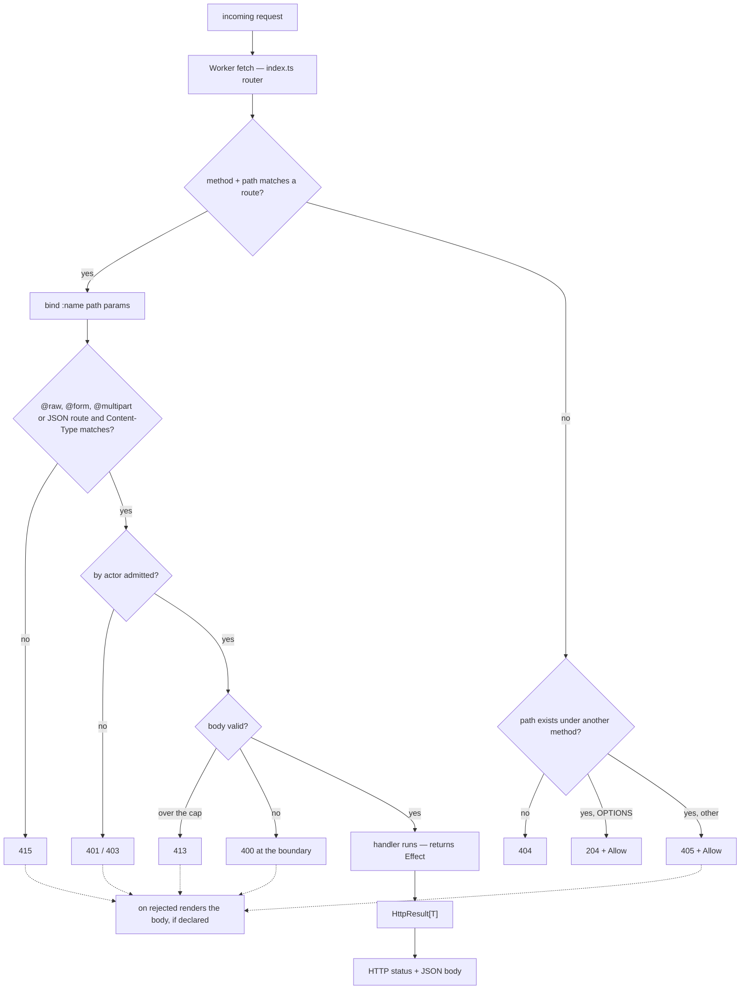

HTTP handlers are declared in a `service` inside a `context`. See the
[grammar for HTTP handlers](/reference/grammar/#rule-http_handler) for the production
and the diagnostics that govern it.

## Handler form

```bynk,ignore
service <Name> from http {
  on <METHOD>("<route>") (<params>) -> Effect[HttpResult[T]] {
    …
  }
}
```

- **Methods:** `GET`, `POST`, `PUT`, `PATCH`, `DELETE`.
- **Route:** must start with `/`; a `:name` segment is a path parameter.
- **Reserved characters:** `*`, `{` and `}` are reserved in a route, in any
  segment and inside a `:name`, for a future form that matches the rest of a
  path (`bynk.http.reserved_route_syntax`). To match one literally, take the
  segment as a `:name` parameter and check it in the handler.
- **Parameters:** each parameter is a path parameter (matching a `:name`
  segment), the special `body` parameter, or the special
  [`headers`](#request-headers), [`query`](#query-strings), [`cookies`](#cookies) or [`cf`](#request-cf) parameter. A path parameter's type is one a typed [`query`](#query-strings) field takes, less
  `Option` and `List` (`bynk.http.path_param_not_stringy`): a `String`, `Int`, `Bool` or
  `Decimal`, an enum, or a refined or opaque type over one of those; see
  [Path parameters](#path-parameters). `GET` and
  `DELETE` may not take a `body` (`bynk.http.body_on_get_or_delete`).
- **Return type:** must be `Effect[HttpResult[T]]`
  (`bynk.http.return_not_effect_http_result`).

> [!DANGER]
> The `/_bynk/` route prefix is reserved for the runtime. Any route under it is
> rejected with `bynk.http.reserved_prefix`.

A `body` parameter is parsed from the request JSON and validated before the
handler runs; an invalid body is rejected with `400` at the boundary — unless the
handler is [`@raw`](#raw-request-bodies), which takes the request's octets as
`Bytes` instead, or [`@form`](#form-bodies), which decodes an HTML form post into
the same kind of record.

A JSON `body` route also checks the request's media type. A `Content-Type` that is
present and is neither `application/json` nor a `+json` type
(`application/problem+json`, `application/vnd.x+json`) is a `415 UnsupportedMediaType`
whose `details` say to send `Content-Type: application/json`: a form or a
`multipart/form-data` post to a JSON route is refused plainly, rather than as a
confusing `400 MalformedJson`. A request with no `Content-Type` is accepted. The check
ignores parameters (`; charset=utf-8`) and case, comes before the auth seam and the
body read, and is the same rejection as a `@raw` route's, so
[`on rejected`](#rendering-rejections) renders it. Note that `curl -d '{…}'` sends
`Content-Type: application/x-www-form-urlencoded` unless `-H 'content-type: application/json'`
is given, so it gets the `415`.

### How a route is chosen {#route-order}

Routes with the same method are compared segment by segment, left to right. At the
first segment where they differ, a literal segment beats a `:name` segment. So
`GET /users/me` answers `/users/me`, and `GET /users/:id` answers every other
`/users/<x>`, whichever is declared first and however the parameter is named:

```bynk,ignore
service api from http {
  on GET("/users/:id") (id: String) -> Effect[HttpResult[String]] by Visitor { … }
  on GET("/users/me") () -> Effect[HttpResult[String]] by Visitor { … }
}
```

- **Overlap is fine.** `/a/:x/c` and `/a/b/:y` both match `/a/b/c`; the second wins,
  because at the second segment its `b` is a literal where the first has a
  parameter. The outcome never depends on how a route is spelt.
- **Percent-decoding.** Every segment is compared decoded, a literal as much as a
  parameter, so `/caf%C3%A9` reaches `GET /café`. A path with a malformed escape is a
  [`400 MalformedPath`](#rendering-rejections).
- **Empty segments don't count.** `/items`, `/items/` and `//items` are the same
  path, so `/items/` reaches `GET /items`. (A `308` redirect to one canonical form
  was considered and left out: it would change every existing service's responses.)
- **A route nothing can reach is an error.** When every path a route matches is
  answered first by other routes of its method, it is
  `bynk.http.unreachable_route`, and the error points at the routes that cover it.
  `GET /a/:x` beside `GET /a/:y` is the plainest case: parameter names are not part
  of the shape. It is checked within a context, and across the members of a
  [worker group](/book/guides/projects-build-and-deployment/deploy-to-cloudflare/),
  whose contexts share one router.
- **Methods.** A request is matched by method and path. The `Allow` set for a path
  (see [Method semantics](#method-semantics)) is the union over the routes that
  match it, so an overlap can't hide a method.

### Path parameters {#path-parameters}

A `:name` segment binds a handler parameter of the same name, and the parameter takes the
types a typed [`query`](#typed-query) field takes, less `Option` and `List` (a segment is
always present and holds one value): a `String`, `Int`, `Bool` or `Decimal`, an enum, or a
refined or opaque type over one of those. Anything else is
`bynk.http.path_param_not_stringy`.

```bynk,ignore
type OrderNo = Int where Positive
type Status = enum { Open, Closed }

on GET("/orders/:id") (id: OrderNo) -> Effect[HttpResult[Order]] by v: Visitor { … }
on GET("/orders/status/:s") (s: Status) -> Effect[HttpResult[List[Order]]] by v: Visitor { … }
```

- **Matching is by shape; decoding follows.** A route matches on its segment count and
  literals alone, so a parameter's type never changes which route answers (a typed
  parameter is a `:name` segment for [ordering](#route-order) and for
  `bynk.http.unreachable_route`, and `/orders/:id` with `Int` beside `/orders/:slug` with
  `String` leaves the one spelt later unreachable, not two routes). Each parameter is decoded after the
  route is chosen.
- **A segment that does not read** is a `400 StructuralMismatch` at `path.<name>`
  (`/orders/abc` for `id: OrderNo`), not a `404` and not a fall-through to another route:
  the path's shape named a resource, with an identifier that is not valid. A segment that
  reads but breaks a refinement (`/orders/0`) is a `400 RefinementViolation`, as for a
  `String`-based type.
- **Reading rules are `query`'s.** An `Int` is `-?[0-9]+` within the safe-integer range (so
  `/orders/007` and `/orders/7` are the same value and reach the same handler, as in a query
  string; a type that wants one canonical form refines it, or takes a `String`), a
  `Decimal` reads its text form, an enum is its variant's name (case-sensitive), and a
  `Bool` is `true` or `false` only (`on` and `off` are a form's convention).
- `bynk client` takes the typed value and writes it as the segment (`String(n)`, the
  variant name), and `bynk openapi` gives the parameter its type, `format` and `enum`.

## Request headers

A handler that needs the request's headers declares a `headers: RequestHeaders`
parameter. It may sit anywhere among the parameters; the router passes the
request's own headers. `RequestHeaders` is a read-only view with three methods:

| Method | Returns | Reads |
|---|---|---|
| `get(name)` | `Option[String]` | any header, by case-insensitive name |
| `bearer()` | `Option[String]` | the token of an `Authorization: Bearer <token>` header |
| `clientIp()` | `Option[String]` | the platform's `CF-Connecting-IP` (see below) |

```bynk,fragment
on GET("/whoami") (headers: RequestHeaders) -> Effect[HttpResult[String]] by v: Visitor {
  match headers.bearer() {
    Some(token) => Ok("token \(token)")
    None => Unauthorized
  }
}
```

`clientIp()` reads `CF-Connecting-IP`, which Cloudflare's edge sets on every
request, overwriting any value the client sent. It is the client's address
only behind that edge: under `bynk dev`, in tests, or on any other host, the
caller sets the header, so don't rate-limit or audit by it there.

This is how a service implements an existing API's authentication scheme, one an
[actor](/reference/actors/) does not describe. Where an actor fits, prefer
it: the seam verifies the credential before the handler runs.

A route whose `by` actor's seam consumed a credential does not show it in this view. On a `Bearer` or `Oidc`
route the `Authorization` header is omitted, so `get("authorization")` and `bearer()` are `None`; on a
`Signature` route the signature header is omitted (the body stays readable). A `SignedCookie` route omits its
session cookie, and on an actor sum every member's credential is omitted. A handler that must forward a token
downstream can't take it from here. A `by v: Visitor` route consumed nothing, so the example above works.

The view is read while the request is handled, never kept: `RequestHeaders` can't
be a field of a type or cross a boundary (a call, a message, an agent), though a
plain function may take it to share a check between handlers
(`bynk.types.headers_at_boundary`). A parameter named `headers` must have this
type, or be a record (`bynk.http.headers_wrong_type`); see [a typed `headers`](#typed-headers).
A test builds a `RequestHeaders` with [`RequestHeaders.of`](/reference/testing/#request-headers).

### A typed `headers` {#typed-headers}

A handler that reads headers it expects, say `Idempotency-Key`, `If-Match` or `Content-Length`,
declares `headers: T`, where `T` is a record. The router decodes the request's headers into it,
and validates them, before the handler runs, as it does a typed [`query`](#typed-query) and
[`cookies`](#cookies): the handler sees only valid input.

```bynk,ignore
type IdempotencyKey = String where MinLength(16) && MaxLength(64)

type UploadHeaders = {
  @name("content-length")  length: Int where NonNegative,
  @name("idempotency-key") key:    Option[IdempotencyKey],
  @name("if-match")        ifMatch: Option[String],
}

@raw(contentType: "application/zip")
on PUT("/archives/:name") (name: ArchiveName, headers: UploadHeaders, body: Stream[Bytes])
    -> Effect[HttpResult[()]] by u: User given Archives {
  let _ <- Archives.putStream(name.value, body, headers.length)
  NoContent
}
```

- **The field rules are `query`'s and `cookies`'s.** A field is a `String`, `Int`, `Bool` or
  `Decimal`, an enum, or a refined or opaque type over one, an `Option` of one (an absent header
  is `None`) or a `List` of one; a default fills an absent header; headers the record does not
  declare are ignored (`bynk.http.headers_field_not_stringy`). A value that does not read as its
  type, a missing required header and a refinement failure are each a `400` naming
  `headers.<field>`, as `StructuralMismatch` or `RefinementViolation`.
- **Names match without case.** A field's name, or its `@name`, is the header's name; `@name` is
  needed for any header with a `-`. A `@name` must be an RFC 9110 token, and two fields whose names
  differ only in case are the same header (`bynk.types.field_name_duplicate`).
- **A `List` splits a comma-separated value.** Repeated header lines are one combined value, as
  HTTP specifies, and a `List` field splits it at commas outside quoted strings
  (RFC 9110 §5.6.1), so `a, "b,c", d` is three values. Any other field reads the combined value
  whole, trimmed of surrounding whitespace, so `Date` and `User-Agent`, which contain commas, are
  plain `String`s. The platform cannot tell a repeated line from a comma, so a field that must be
  single uses a refinement.
- **Values are not otherwise decoded.** There is no percent-decoding, as for cookies; a field that
  must reject whitespace or an encoding uses a refinement.
- **`RequestHeaders` stays**, and the two forms are exclusive: a handler has one `headers`
  parameter, of either type. To enumerate or forward every header, use `RequestHeaders`.
- **A header is client-supplied input, not proof of identity.** The record is decoded after the
  route's actor has run, like every other input. Use an [actor](/reference/actors/) for
  authentication. A credential header the route's seam consumed (`Authorization` on a `Bearer`
  route, the signature header, a `SignedCookie` route's session cookie within a `cookie` field) reads
  as absent here too, so the compiler refuses a required field that reads one
  (`bynk.http.headers_field_consumed`: the message names the field, the header and the actor that consumes it) rather than let the route
  answer `400` on every request; take the identity from the actor's principal instead. An `Option`
  or `List` field is allowed, because it is merely always empty, but it draws
  `bynk.http.headers_field_consumed_optional`. For a `SignedCookie` route only the session cookie is
  removed from `cookie`, so a `cookie` field is flagged as absent unless the request carries another
  cookie too; read cookies through a [`cookies`](#cookies) record instead.
- **Headers the platform adds.** A proxy or Cloudflare may add or rewrite headers
  (`CF-Connecting-IP`, `CF-Ray`, …); for platform facts, prefer [`cf: RequestCf`](#request-cf).
- **A list item cannot hold a comma or a double quote.** The router splits at commas outside
  quoted strings and keeps the quotes, so such an item would not arrive as one value. `bynk client`
  and a `system` test driver refuse it (`headers.<field>`) rather than send a different list.
- `bynk client` sends the fields as request headers, and `bynk openapi` describes them as `in: header`
  parameters. A test passes a `T` value for `headers`; at `system` it is sent as headers, and a `Wire`
  argument carries header text (`name: value` lines) to probe the decoding.

## Cloudflare request metadata {#request-cf}

A handler that wants what Cloudflare derived about the connection (the caller's
country, the data centre that served the request, the ASN) declares a
`cf: RequestCf` parameter. It may sit anywhere among the parameters. `RequestCf` is
a record in `bynk.cloudflare`, so naming it needs `consumes bynk.cloudflare { RequestCf }`
and locks the deployment unit to Cloudflare (a platform lock, as for any
`bynk.cloudflare` name). It is experimental: using it needs `bynk.cloudflare.RequestCf`
in `[unstable] allow`.

```bynk,ignore
consumes bynk.cloudflare { RequestCf }

service api from http {
	on GET("/hello") (cf: RequestCf) -> Effect[HttpResult[String]] by v: Visitor {
		match cf.country {
			Some("GB") => Ok("Hello")
			_ => Ok("Hi")
		}
	}
}
```

| Field | Type | `request.cf` property |
|---|---|---|
| `country`, `continent`, `city`, `region`, `regionCode`, `postalCode`, `timezone` | `Option[String]` | the property of the same name |
| `latitude`, `longitude` | `Option[Float]` | the property of the same name, which Cloudflare sends as a numeric string |
| `colo` | `Option[String]` | `colo`, the data centre's airport code |
| `asn` | `Option[Int]` | `asn` |
| `asOrganization`, `httpProtocol`, `tlsVersion` | `Option[String]` | the property of the same name |
| `isEuCountry` | `Option[Bool]` | `isEUCountry`, which Cloudflare sends as `"1"` for a country in the EU |

**Every field is optional**, and the parameter is not: a request with no
`request.cf` (a test, the dashboard's preview) gives a `RequestCf` whose fields are
all `None`, never a fault, so the handler reads `cf.country` without first matching
on whether `cf` is there. A property of an unexpected type is `None` too. The set is
the initial one; a field is added later as a defaulted field, which does not break a
handler. The plan-dependent properties (bot management, client certificates) are not
part of it.

The facts come from the client's IP address, so they can be personal data, and they
are best-effort: a VPN or a proxy makes them wrong. Cloudflare documents the
properties on [its Request page](https://developers.cloudflare.com/workers/runtime-apis/request/).

`cf` is not part of a route's wire contract: [`bynk client`](/reference/http-client/) and
`bynk openapi` leave it out, so a handler that declares it has
the same client and the same OpenAPI document as without it. A parameter named `cf`
must be typed `RequestCf` (`bynk.http.cf_wrong_type`), and a `:cf` path segment
stays a path parameter.

A test builds one with the record literal: `RequestCf { country: Some("GB") }`, and
`RequestCf {}` for a request with none. At the `system` tier the request is real, so
`cf` carries whatever the platform supplies there, and the argument a case passes is
not sent.

## Query strings

A handler reads the request's query string through a `query` parameter, in one
of two forms. It may sit anywhere among the parameters, and a handler has at most
one. A `:query` path segment keeps its meaning as a path parameter.

### A typed `query` {#typed-query}

`query: T`, where `T` is a record, decodes the query string into `T` and
validates it before the handler runs, as a [`body`](#handler-form) is:

```bynk,fragment
type Limit = Int where InRange(1, 500)
type Day = String where Matches("^\\d{4}-\\d{2}-\\d{2}$")

type ActivityFilter = {
  repo:  Option[String],
  since: Option[Day],
  tag:   List[String] = [],
  limit: Limit = 50,
}
```

```bynk,fragment
on GET("/activity") (query: ActivityFilter) -> Effect[HttpResult[List[Activity]]] by r: Reader { Ok([]) }
```

`GET /activity?repo=bynk-lang/bynk&tag=a&tag=b&limit=100` decodes to a filter;
`?limit=0` or `?since=yesterday` is a `400` before the handler runs, with the same
`RefinementViolation` or `StructuralMismatch` body a bad `body` gets (the `path`
names the field, `query.limit`).

A `RefinementViolation` body names the field, the message and the rule that failed, and
never the value that was rejected, so a rejected password is not echoed back:

```json
{ "kind": "RefinementViolation", "path": "body.note",
  "violation": { "field": "Note", "message": "length must be at most 280",
                 "rule": { "kind": "MaxLength", "limit": 280 } } }
```

`rule` is the `ValidationRule` of `e.rule` ([types](/reference/types/#validationerror)),
written as every sum is on the wire; a `Decimal` bound is its canonical text and a `Duration`
bound its milliseconds. A client that read `violation.value` from an earlier body must stop.

A field of `T` is a value a query string can carry:

- a `String`, `Int`, `Bool` or `Decimal`, a refined or opaque type over one of
  those, or an enum (`?kind=Push`);
- an `Option` of one, which is `None` when its key is absent;
- a `List` of one, filled by a repeated key (`?tag=a&tag=b`). It is empty only
  when the field has a default, as `tag` does above; with none, an absent key is a
  `400` (give it a default of `[]` to make the key optional).

Anything else is refused (`bynk.http.query_field_not_stringy`), and so is a
`query` that is not a record (`bynk.http.query_wrong_type`). A field's default
applies when its key is absent. Names and values are percent-decoded, and `+` is
a space, as `bynk.url.decodeQuery` reads them.

Two decisions keep the boundary strict where it matters and tolerant where it
doesn't:

- **Unknown keys are ignored**, as unknown fields of a `body` are: a cache-buster
  or a tracking parameter (`?utm_source=…`) is not an error.
- **A repeated key on a field that is not a `List` is a `400`** (`StructuralMismatch`),
  rather than the first value silently winning: `?limit=1&limit=2` is ambiguous,
  and the boundary says so.

The query never affects *which* handler runs. Routes are still told apart by
method and path alone.

### The raw view — `query: RequestQuery` {#request-query}

For a proxy, or keys only known at run time, a handler declares
`query: RequestQuery`, a read-only view of the query string. It mirrors
[`RequestHeaders`](#request-headers), and nothing is validated:

| Method | Returns | Reads |
|---|---|---|
| `get(name)` | `Option[String]` | the first value of a key |
| `all(name)` | `List[String]` | every value of a key, in order (`[]` when absent) |
| `params()` | `Map[String, List[String]]` | every key with its values |

```bynk,fragment
on GET("/echo") (query: RequestQuery) -> Effect[HttpResult[String]] by v: Visitor {
  Ok(query.get("q").getOrElse("-"))
}
```

The view is read while the request is handled, never kept: `RequestQuery` can't be
a field of a type or cross a boundary (`bynk.types.request_query_at_boundary`), and only an
HTTP handler's `query` can have it (`bynk.http.query_not_http`). A test builds one
with [`RequestQuery.of`](/reference/testing/#request-query).

## `HttpResult` variants

The vocabulary tracks the common, modern HTTP status codes (RFC 9110). A
variant's payload is one of seven shapes: the value `T` as JSON (`Value`), a
target URL emitted as a `Location` header (`Location`), an explanatory
`message` as an `{ "error": … }` JSON body (`Message`), a `Stream[String]`
emitted as an SSE (`text/event-stream`) body (`Streamed`), a raw
`Bytes` body under an author-declared `content-type` (`Raw`, and `RawCreated` at
`201`), the same with the entity tag its `ETag` carries (`RawTagged`), a
`Stream[Bytes]` body streamed chunk by chunk (`RawStreamed`), or no body at all
(`None`).

### 2xx success

| Variant | Status | Payload |
|---|---|---|
| `Ok(value)` | 200 | the value, as JSON |
| `Streaming(stream)` | 200 | a `Stream[String]`, SSE-framed (see [Streamed responses](#streamed-responses)) |
| `Raw(body, contentType)` | 200 | a `Bytes` body under the given `content-type` (see [Raw responses](#raw-responses)) |
| `RawTagged(body, contentType, etag)` | 200 | as `Raw`, sent with `etag` as its `ETag` (see [Supplying the validator](#supplying-the-validator-rawtagged)) |
| `RawStreamed(body, contentType)` | 200 | a `Stream[Bytes]` body, streamed chunk by chunk (see [Streamed raw responses](#streamed-raw-responses)) |
| `RawCreated(body, contentType)` | 201 | as `Raw` (see [Raw responses](#raw-responses)) |
| `Created(value)` | 201 | the value, as JSON |
| `Accepted(value)` | 202 | the value, as JSON |
| `NoContent` | 204 | none |

### 3xx redirection

A redirect carries the target URL, emitted as a `Location` header with an empty
body.

| Variant | Status | Payload |
|---|---|---|
| `MovedPermanently(url)` | 301 | `Location` header |
| `Found(url)` | 302 | `Location` header |
| `SeeOther(url)` | 303 | `Location` header |
| `TemporaryRedirect(url)` | 307 | `Location` header |
| `PermanentRedirect(url)` | 308 | `Location` header |

### 4xx client error

| Variant | Status | Payload |
|---|---|---|
| `BadRequest(message)` | 400 | message |
| `Unauthorized` | 401 | none, with the route's [`WWW-Authenticate` challenge](/reference/actors/#the-401-challenge) |
| `Forbidden` | 403 | none |
| `NotFound` | 404 | none |
| `MethodNotAllowed` | 405 | none |
| `NotAcceptable` | 406 | none |
| `RequestTimeout` | 408 | none |
| `Conflict(message)` | 409 | message |
| `Gone` | 410 | none |
| `LengthRequired` | 411 | none |
| `PreconditionFailed(message)` | 412 | message |
| `PayloadTooLarge(message)` | 413 | message |
| `UnsupportedMediaType(message)` | 415 | message |
| `UnprocessableEntity(message)` | 422 | message |
| `PreconditionRequired(message)` | 428 | message |
| `TooManyRequests(message)` | 429 | message |
| `UnavailableForLegalReasons(message)` | 451 | message |

### 5xx server error

| Variant | Status | Payload |
|---|---|---|
| `ServerError(message)` | 500 | message |
| `NotImplemented(message)` | 501 | message |
| `BadGateway(message)` | 502 | message |
| `ServiceUnavailable(message)` | 503 | message |
| `GatewayTimeout(message)` | 504 | message |

A handler that faults answers `500` and is logged and reported as a fault. One fault is
answered differently (#3932): an agent call that waited past its queue limit
(`AgentBusy`, see [one handler at a time](/reference/agents/#one-handler-at-a-time)) is
load, not a bug, so the route answers `503 Service Unavailable` with `Retry-After: 1`,
logs it as busy with the queue depth, and does not report it as a fault. A
`ReentrantAgentCall` is a bug and stays a `500`.

> [!TIP]
> A bare `Ok(…)` builds whatever the expected type says (a `let` annotation, a
> match arm, an argument) and otherwise follows the handler's return type. So in a
> handler returning `HttpResult[_]`, `let r: Result[Int, String] = Ok(1)` is a
> `Result`. Qualify it (`Result.Ok(…)`, `HttpResult.Ok(…)`) to choose explicitly
> (#1659).

## Error bodies

The error variants answer with Bynk's own body: `{ "error": message }`, or no body
at all. A service that implements an existing API's contract needs that API's error
shape instead. `RawError(status, body, contentType)` answers an error status with a
[`Bytes`](/reference/types/#bytes) body you choose, under the content type you
give, and runs no codec, just as [`Raw`](#raw-responses) does for a `200`:

```bynk,fragment
fn problem(code: String, message: String) -> Bytes {
  Bytes.fromUtf8("{\"error\":\"\(code)\",\"message\":\"\(message)\"}")
}
```

```bynk,fragment
on PUT("/packages/:name") (name: String, body: String) -> Effect[HttpResult[()]] by v: Visitor {
  RawError(Conflict, problem("conflict", "\(name) already exists"), "application/json")
}
```

The status is an `ErrorStatus`: the name of one of the 4xx or 5xx variants in the
tables above (`Forbidden`, `Conflict`, `ServiceUnavailable`, …), bare or qualified
(`ErrorStatus.Forbidden`). Only those names are accepted, so a `RawError` can't
answer a 2xx or 3xx (`bynk.http.raw_error_status`). The status is fixed where the
response is built: `ErrorStatus` is not a type, so a helper takes the parts of the
body and the handler names the status (`bynk.http.error_status_position`).

A test matches a `RawError` by its number: `expect r is RawError(409, _, _)`. A
system-tier test decodes the response by its status, as it does for every
variant, so there the same response reads as `Conflict(_)`.

To answer every error in the standard RFC 9457 shape instead, without writing the body
yourself, see [Problem details](#problem-details).

## Problem details {#problem-details}

A service whose clients are not Bynk's can answer every error in one standard shape. With
`errors { format: problem }`, an error variant and a router rejection each answer an
[RFC 9457](https://www.rfc-editor.org/rfc/rfc9457) `application/problem+json` body:

```bynk,fragment
service api from http {
  errors { format: problem }

  on POST("/widgets/:id/reserve") (id: String) -> Effect[HttpResult[()]] by v: Visitor {
    Conflict("widget is out of stock")
  }
}
```

```json
{ "type": "about:blank", "title": "Conflict", "status": 409, "detail": "widget is out of stock" }
```

A request the router refuses before the handler runs answers the same way, with a stable `type`
and the rejection's own members (`kind`, `path`, and a refinement's `violation`) as extension members:

```json
{ "type": "https://bynk-lang.org/problems/refinement-violation", "title": "Bad Request", "status": 400,
  "detail": "body.qty: must be positive", "kind": "RefinementViolation", "path": "body.qty",
  "violation": { "field": "qty", "message": "must be positive", "rule": { … } } }
```

| Field | Holds |
|---|---|
| `status` | the response's status |
| `title` | the status's reason phrase |
| `detail` | the variant's message, or the rejection's detail; absent when there is none |
| `type` | `about:blank` for an error variant (RFC 9457 §4.2.1); `https://bynk-lang.org/problems/<kind>` for a router rejection |
| `kind` and the rejection's other members | a router rejection's kind, and what it carries: `path`; `expected` and `actual` of a structural mismatch; `violation` (the `field`, `message` and `rule`, never the rejected value) of a refinement |

The rejection types are stable, and new kinds are additive. The URI is an identifier, listed
here once:

| Rejection | `type` | Status |
|---|---|---|
| `MalformedJson` {#problem-malformed-json} | `https://bynk-lang.org/problems/malformed-json` | `400` |
| `MalformedForm` {#problem-malformed-form} | `https://bynk-lang.org/problems/malformed-form` | `400` |
| `MalformedPath` {#problem-malformed-path} | `https://bynk-lang.org/problems/malformed-path` | `400` |
| `StructuralMismatch` {#problem-structural-mismatch} | `https://bynk-lang.org/problems/structural-mismatch` | `400` |
| `RefinementViolation` {#problem-refinement-violation} | `https://bynk-lang.org/problems/refinement-violation` | `400` |
| `PayloadTooLarge` {#problem-payload-too-large} | `https://bynk-lang.org/problems/payload-too-large` | `413` |
| `UnsupportedMediaType` {#problem-unsupported-media-type} | `https://bynk-lang.org/problems/unsupported-media-type` | `415` |

The default is `format: bynk`, and with it every error body is what it always was, byte for byte.
A handler overrides the service with `@errors(format: bynk)` or `@errors(format: problem)`; the route
wins, then the service. What the format does not touch: a `RawError` body, which you chose; an
[`on rejected`](#rendering-rejections) handler, which still replaces the router's body; a status
that has no body (`401`, `403`, `404`, `405`), because RFC 9457 does not require one; the `500` a
fault answers; and every success body. A shared mapping function that returns `HttpResult[T]`
needs no change: its variants render as problems in this mode. `bynk openapi` documents the
errors of such a route as `application/problem+json` with a shared `BynkProblemDetails`
schema, and `bynk client` types them as `problem: Problem`.

The section is legal only on a `from http` service (`bynk.http.errors_not_http`), at most once
(`bynk.parse.duplicate_errors`), and its one field is `format` (`bynk.http.errors_unknown_field`),
whose value is `bynk` or `problem` (`bynk.http.errors_invalid_field`). `@errors` follows the same
rules, and at most one per handler (`bynk.http.errors_duplicate`).

## Rendering rejections

The router refuses some requests before any handler runs: a `400` for a body or
path parameter that fails to parse or validate (or for a path whose percent-encoding
does not decode, `MalformedPath`), a `405` for a method the path
doesn't declare, a `413` for a body over its cap, a `415` for a `@raw`, `@form` or `@multipart` route's
other content type, and a `401` from a `Signature` seam. Each answers in Bynk's own
shape, `{ "kind": …, "details": … }` or no body. A service whose contract says
otherwise renders them itself with `on rejected`:

```bynk,fragment
on rejected(why: BoundaryRejection) -> Effect[HttpResult[()]] {
  match why {
    PayloadTooLarge(_) => RawError(PayloadTooLarge, problem("too_large", "the body is too large"), "application/json")
    MethodNotAllowed => RawError(MethodNotAllowed, problem("method", "no such method"), "application/json")
    _ => RawError(BadRequest, problem("bad_request", "the request is malformed"), "application/json")
  }
}
```

`why` is the rejection: `MalformedJson(detail)`, `StructuralMismatch(detail)`,
`RefinementViolation(detail)`, `PayloadTooLarge(detail)`,
`UnsupportedMediaType(detail)`, `MalformedForm(detail)`, `MalformedPath(detail)`,
`MethodNotAllowed` or `Unauthorized`.

The status is the rejection's own. The handler supplies the body, so it answers a
`RawError` of that status; the router keeps its other headers (the `WWW-Authenticate` of a
`401`, the `Allow` of a
`405`) and stamps the service's CORS and security headers as usual. Any other
answer, another status or a fault in the handler sends the router's default
response instead, and logs why. A service without `on rejected` is unchanged.

The hook renders the rejections of its own service's routes. A `405` belongs to
a path rather than a route, so when two `from http` services in one context share
a path, the path's `405` uses the hook of the service declared first, just as its
CORS and security headers do. A service with `on rejected` and no routes
compiles; its hook is never called.

A service has at most one (`bynk.http.duplicate_rejected`). It takes exactly the
`BoundaryRejection` and returns `HttpResult[()]`, and it has no `by` (it runs before
any actor is known) and no `given` (`bynk.http.rejected_signature`). The `401`s an
actor's Bearer or OIDC seam returns, and the body refusals of a route whose `by`
is a sum of actors, are not rendered through it yet.

## Lifting an `Option` with `?` (v0.153)

Inside a handler returning `HttpResult[T]` (or `Effect[HttpResult[T]]`), the `?`
operator lifts an `Option`: `Some(v)` yields `v`, and `None` **early-returns
`NotFound` (404)**. This collapses the outer half of the ubiquitous read →
respond pyramid — a lookup that misses becomes a 404 without a `match`:

```bynk,fragment
on GET("/links/:code") (code: Slug) -> Effect[HttpResult[String]] by v: Visitor given Kv {
  let stored <- Kv.get(code.value)   // stored : Option[String]
  let raw = stored?                  // None → 404 NotFound; Some(s) → s
  Ok(raw)
}
```

In a function returning an `Option`, `?` returns the `None` as it is; here, where the
enclosing return is an `HttpResult`, it becomes a `404`. In a `Result`-returning function
the checker rejects it with `bynk.types.question_option_outside_http` (use `.okOr(err)` to
turn an `Option` into a `Result`). A `Result`
under `?` is unchanged: its `Err` propagates as before. `?` on a `Result` never picks a status:
mapping a **domain error** into an `HttpResult` is handler policy (ADR 0178, decision F), made in
the handler where the call is, so a status decision is not hidden in a table elsewhere. To reuse
a mapping, write it once as a function returning `HttpResult[T]` and call it at each site (see
[Map a domain error to a status once](/book/guides/entry-points/map-a-domain-error-to-a-status/));
[Answering another status](#answering-another-status) has the pieces.

In an `HttpResult` handler, `?` on an `Option` **always means `404`**. That is right for "the thing you asked
for is not there" (a lookup that misses), and wrong for a missing or malformed
request input, which is a `400`. Hovering the `?` in an editor names both of its meanings, and
`RequestHeaders.get(…)?` is flagged by
`bynk.http.header_question_not_found` (below).

### Answering another status

`let … else` names the status. At the top of a handler body the `else` block's
value is the handler's result, so a bare `BadRequest(…)` is accepted there:

```bynk,fragment
on POST("/github") (headers: RequestHeaders, body: Bytes) -> Effect[HttpResult[String]] by GitHub {
  let Some(event) = headers.get("X-GitHub-Event") else { BadRequest("missing X-GitHub-Event") }
  let Some(row) = stored else { NotFound }     // the 404 case, spelled out
  Ok(event)
}
```

Where the `None` arm needs a computed answer, use `else match { None => … }`. A
wrongly typed `else` is rejected with `bynk.types.match_arm_mismatch`.

### The header lint

`headers.get("X")?` in an `HttpResult` handler is the shortest spelling of the
wrong status: a delivery missing the header would answer `404`, telling the
sender the URL does not exist. The checker warns
(`bynk.http.header_question_not_found`, a non-failing warning) on exactly that
shape — `get` on a `RequestHeaders` value, under `?`, in an `HttpResult`
handler. Query parameters, parsed bodies and every other `Option` are not
flagged: `?` keeps its `404` there. When the `?` is the whole value of a plain
`let x = headers.get("X")?`, the warning carries a machine-applicable fix
(`bynk check --fix`, or the editor's quick fix) that rewrites it to the
`let Some(x) = headers.get("X") else { BadRequest("missing X") }` above, keeping
the binding name and leaving the message for you to edit.

## Cookies

A handler reads the request's cookies through a `cookies: T` parameter, where `T` is a
record. The router parses the `Cookie` header, decodes it into `T` and validates it before
the handler runs, as it does a typed [`query`](#typed-query): refinements, defaults,
`Option` and `List` fields, and a `400` with the same `RefinementViolation` or
`StructuralMismatch` body a bad `body` gets (the `path` names the cookie,
`cookies.sid`). The parameter may sit anywhere among the parameters.

```bynk,fragment
type Token = String where NonEmpty && MaxLength(128)
type Theme = enum { Light, Dark }

type Session = {
  sid:   Option[Token],
  theme: Theme = Light,
}
```

```bynk,fragment
on GET("/me") (cookies: Session) -> Effect[HttpResult[String]] by v: Visitor {
  match cookies.sid {
    Some(_) => Ok("signed in")
    None => Unauthorized
  }
}
```

A field of `T` is a value a cookie can carry, the set a typed `query` takes: a `String`,
`Int`, `Bool` or `Decimal`, a refined or opaque type over one of those, or an enum;
an `Option` of one, which is `None` when the cookie is absent; or a `List` of one, filled
by a name sent twice. Anything else is refused (`bynk.http.cookies_field_not_stringy`), and
so is a `cookies` that is not a record (`bynk.http.cookies_wrong_type`).

- **Parsing.** The header is read as RFC 6265 §5.4 describes: pairs split on `;`, each on its
  first `=`, names and values trimmed, one pair of double quotes dropped from a value. A pair
  with no `=`, or an empty name, is ignored. Cookies the record does not name are ignored,
  so an analytics cookie is not an error.
- **No decoding.** A cookie value is opaque. It is **not** percent-decoded, so `a%41` is the
  five characters it is, and the writer emits what it is given. A service that stores
  structured data in a cookie encodes it itself (`toBase64Url`, `Json.encode`).
- **A name sent twice.** A browser sends the longer-`Path` cookie first when two share a
  name. On a field that is not a `List` that is a `400` (`StructuralMismatch`), rather than the
  first one silently winning, as for a repeated query key.
- **An empty cookie** (`a=`) is a value, not an absent one.

A cookie is not authentication: it reaches the router from the client, so treat every field
as input to check. A cookie-backed actor is separate: see
[Signed cookies](/reference/actors/#signed-cookies).

### Reading a prefixed cookie {#request-cookies}

A cookie named `__Host-sid` or `__Secure-id` is not a legal record field name. There are two
ways to read it. The typed way is a [`@name`](/reference/types/#field-name) on the field,
which gives it the key the browser sends, so the value is decoded and validated before the
handler runs:

```bynk,fragment
type SessionCookies = {
  @name("__Host-sid") sid: Option[Token],
}
```

```bynk,fragment
on GET("/me") (cookies: SessionCookies) -> Effect[HttpResult[String]] by v: Visitor {
  match cookies.sid {
    Some(t) => Ok("\(t)")
    None => Unauthorized
  }
}
```

The other is `cookies: RequestCookies`: the raw, read-only view of the request's cookies. It
is not decoded or validated at the boundary, so the handler builds the values it needs. Use it
when the names are not known until the request arrives.

```bynk,fragment
on GET("/me") (cookies: RequestCookies) -> Effect[HttpResult[String]] by v: Visitor {
  match cookies.get("__Host-sid") {
    Some(raw) => Ok(raw)
    None => Unauthorized
  }
}
```

| Method | Type | Meaning |
|---|---|---|
| `get(name)` | `Option[String]` | the first cookie of that name |
| `all(name)` | `List[String]` | every cookie of that name, in header order |
| `names()` | `List[String]` | each name once, in order of first appearance |

Parsing is the typed form's: RFC 6265 §5.4, no decoding. Pass the value through a refined
type's `.of` (`Token.of(raw)`) to check it. A `RequestCookies` may only be a handler's
`cookies` parameter (`bynk.http.cookies_not_http`; it cannot be stored or sent,
`bynk.types.request_cookies_at_boundary`). Reading `__Host-` cookies this way is the
defence against cookie tossing, since a sibling subdomain cannot set one.

### Setting cookies

`bynk` exports a `Cookie` record and a `SameSite` enum (`Strict`, `Lax`, `Unrestricted`;
the last is `SameSite=None`). `withCookie` attaches a cookie to any `HttpResult`, and the
router sends one `Set-Cookie` header for each.

```bynk,fragment
on POST("/login") () -> Effect[HttpResult[String]] by v: Visitor {
  Created("ok").withCookie(Cookie { name: "sid", value: "abc", maxAge: Some(30.minutes) })
}
```

The defaults are the safe ones: `path: "/"`, `secure: true`, `httpOnly: true`,
`sameSite: Lax`, `partitioned: false`, and no `domain`, `maxAge` or `expires`, so the
cookie ends with the browser session. A literal that sets one of these unsafe is refused
or warned about:

| Diagnostic | When |
|---|---|
| `bynk.http.cookie_samesite_none_insecure` | `sameSite: SameSite.Unrestricted` with `secure: false` |
| `bynk.http.cookie_partitioned_insecure` | `partitioned: true` with `secure: false` |
| `bynk.http.cookie_host_prefix` | a `__Host-` name that is not `secure`, has a `domain`, or a `path` other than `/` |
| `bynk.http.cookie_secure_prefix` | a `__Secure-` name that is not `secure` |
| `bynk.http.cookie_script_readable` | `httpOnly: false` (a warning) |
| `bynk.http.cookie_domain_widens` | a `domain` on a cookie whose name is not `__Host-` (a warning): every subdomain receives it |
| `bynk.http.cookie_cross_site_without_credentials` | a service attaches a `SameSite.Unrestricted` cookie but has no `cors { credentials: true }` (a warning): a cross-origin `fetch` can never send it back |
| `bynk.http.cookie_untyped_has_field` | an untyped `Cookie` literal named like a field of a `cookies` record of the unit (a warning): write it with `Record.field.cookie(v)`, which the quick-fix does where it can |
| `bynk.http.cookie_value_undecodable` | the same literal, with a `value` that field's decoder rejects (`"dark"` for an enum read as `Dark`) |
| `bynk.actor.signed_cookie_write_literal` | a literal named like a `SignedCookie` actor's session cookie: only `Actor.issue` and `Actor.expire` write it |
| `bynk.http.cache_public_reads_cookies` | `@cache(scope: public)` on a handler that takes `cookies` |

Only a literal is judged. A computed cookie is checked when it is sent: a name that is not
a token, a value with whitespace, a quote, `,`, `;`, `\` or a control character, an
unsafe `Domain` or `Path`, an `Expires` outside the range of dates, or a header over
4096 bytes faults the request (`500`) rather than sending a malformed or unsafe header.

`clearCookie(c)` removes a cookie: it sends `c` again, empty, with `Max-Age=0` and an
epoch `Expires`, under the same name, `Domain` and `Path`, which is what a browser matches
on. It keeps the cookie's own `secure` and `sameSite`, so build it as the cookie was set.

```bynk,fragment
on POST("/logout") () -> Effect[HttpResult[()]] by v: Visitor {
  NoContent.clearCookie(Cookie { name: "sid", value: "" })
}
```

#### Writing a cookie from its record {#typed-cookie-write}

A name and a value written by hand are not tied to the record that reads the cookie. When
the cookie is a field of a `cookies` record, write it from the field instead:

```bynk,fragment
type Theme = enum { Light, Dark }
type Prefs = {
  theme: Theme = Light,
  @name("__Host-visits") visits: Int = 0,
}
```

```bynk,fragment
on POST("/theme/dark") () -> Effect[HttpResult[String]] by v: Visitor {
  Ok("dark").withCookie(Cookie { ...Prefs.theme.cookie(Dark), maxAge: Some(365.days) })
}

on POST("/theme/reset") () -> Effect[HttpResult[()]] by v: Visitor {
  NoContent.withCookie(Prefs.theme.expire())
}
```

`Prefs.theme.cookie(Dark)` is a `Cookie` named by the field's wire name (its `@name`, here
`__Host-visits` for `visits`) and valued as the `cookies` decoder reads it: an `Int` is its
digits, a `Bool` is `true` or `false`, an enum is its variant's name, and a `String`, a
refined or opaque type over one, and a `Decimal` are their text. An `Option[T]` field takes a
`T`. Every attribute is the `Cookie` default, so give others by spreading it into a `Cookie`
literal. `Prefs.theme.expire()` is the deletion `Cookie` (empty, `Max-Age=0`, epoch
`Expires`, default `Path` and no `Domain`; a cookie written with another `Path` or `Domain`
needs the same on its deletion). Renaming the field renames the write, and a value of the
wrong type is a type error at the write, not a `400` on the next request.

The record must be the `cookies` parameter of an `on http` handler in this unit
(`bynk.http.cookie_field_not_cookie_record`), the field must exist
(`bynk.http.cookie_field_unknown`), `cookie` takes the one value and `expire` none
(`bynk.http.cookie_field_arity`), and a `List` field is refused, since a repeated name is
several `Set-Cookie` lines (`bynk.http.cookie_field_list`). `Prefs.theme` alone is not a value.
The prefix and attribute rules above apply to a typed cookie too, judged against the field's
wire name: `Cookie { ...Prefs.visits.cookie(n), domain: Some("example.com") }` for a
`__Host-visits` field is `bynk.http.cookie_host_prefix`. The session cookie of a `SignedCookie`
actor cannot be written through a record (`bynk.actor.signed_cookie_write_directly`) or a
literal (`bynk.actor.signed_cookie_write_literal`); only `Actor.issue` and `Actor.expire` write it.
A cookie in no record is still written as a plain `Cookie { name, value }`; where a record reads
the name, the literal draws `bynk.http.cookie_untyped_has_field`.

A response that sets a cookie is one user's, so a `public` cache may not keep it: at
runtime a response carrying `Set-Cookie` is always sent `Cache-Control: private`, and a
conditional-`GET` `304` keeps the `Set-Cookie` of the response it replaces. In a test,
`result.cookies()` reads the `List[Cookie]` a result carries.

## Response headers {#response-headers}

A handler adds a header of its own to any `HttpResult` with `withHeader`, and the status
that has a standard header takes a typed helper:

```bynk,fragment
on GET("/report") () -> Effect[HttpResult[String]] by v: Visitor {
  Ok("ok").withHeader("X-Request-Id", "abc")
}

on POST("/things") (body: String) -> Effect[HttpResult[String]] by v: Visitor {
  Created(body).at("/things/1")
}

on GET("/slow") () -> Effect[HttpResult[String]] by v: Visitor {
  TooManyRequests("slow down").retryAfter(30.seconds)
}

on GET("/export") () -> Effect[HttpResult[Bytes]] by v: Visitor {
  Raw(Bytes.fromUtf8("a,b"), "text/csv").download("report.csv")
}
```

| Method | Writes | Applies to |
|---|---|---|
| `withHeader(name, value)` | one header line; a repeated name keeps every value | any `HttpResult` |
| `retryAfter(delay)` | `Retry-After`, `delay` in whole seconds, rounded up | `TooManyRequests`, `ServiceUnavailable` |
| `at(url)` | `Location` of the new resource | `Created`, `RawCreated`, `Accepted` |
| `download(filename)` | `Content-Disposition: attachment`, with an ASCII `filename` fallback and the exact name as an RFC 8187 `filename*` | `Raw`, `RawTagged`, `RawStreamed` |

A typed helper is written on the variant itself, after any other header methods
(`TooManyRequests(m).withHeader("X-Reason", "deploy").retryAfter(90.seconds)`), because the router
cannot tell at compile time which variant a stored `HttpResult` holds; on another receiver it is
`bynk.types.method_not_found`. `retryAfter` is whole seconds, so a literal under one second is
refused (`bynk.http.invalid_response_header`).

`withHeader` cannot set a header the router owns: the caching headers (`Cache-Control`, `ETag`,
`Vary`, `Expires`, `Last-Modified`, `Age`, `Pragma` and the CDN directives), `Content-Type` and
`Content-Length`, `Location`, `Retry-After` and `Content-Disposition` (the typed helpers write
those), `Set-Cookie`, the `security { }` headers, the `Access-Control-*` CORS headers,
`WWW-Authenticate`, `Allow` and the hop-by-hop headers. A header value is ASCII: a literal with
another character is `bynk.http.invalid_response_header`, and a computed one answers `500`; `at`
percent-encodes a URL instead. A literal name that is one is
`bynk.http.reserved_response_header`, and its note names the way to set it properly. A literal name
that is not an RFC 9110 token, or a value with a line break or another control character, is
`bynk.http.invalid_response_header`. A name or value computed at run time is judged when the
response is built: a bad one answers `500` and is logged, so a malformed header never reaches the
wire.

In a test, `result.headers()` reads the `Map[String, List[String]]` a result carries, with
lower-case names and each name's values in the order they were added; the headers the router owns
are not in it.

## Method semantics

The methods a path answers are **derived from the routes you declare** — there is
nothing to write. For a service declaring `POST /links` and `GET /links/:code`,
the router synthesises, from that table alone:

| Request | Answer |
|---|---|
| `GET /links` (a live path, wrong method) | `405` with `Allow: OPTIONS, POST` |
| `OPTIONS /links` (a plain, non-preflight `OPTIONS`) | `204` with `Allow: OPTIONS, POST` |
| `HEAD /links/:code` | the `GET` status and headers, with an empty body |
| `OPTIONS /links/:code` | `204` with `Allow: GET, HEAD, OPTIONS` |
| `DELETE /links/:code` (wrong method) | `405` with `Allow: GET, HEAD, OPTIONS` |
| `GET /nope` (no such path) | `404` — unchanged |

The **allowed-method set** for a path is the union of the methods declared on it,
plus `OPTIONS` always, plus `HEAD` whenever `GET` is present. Where routes
[overlap](#route-order), it is the union over every route that matches the request
path. So:

- **`405 + Allow`** — a request to a *live* path with an undeclared method is a
  `405` (not a `404`), carrying the derived `Allow` header (RFC 9110 §15.5.6). A
  request to a path that does not exist is still a `404`.
- **`OPTIONS`** — a plain (non-preflight) `OPTIONS` to a known path is a `204`
  carrying `Allow`. (A CORS preflight — an `OPTIONS` bearing
  `Access-Control-Request-Method` — is answered by the [CORS](#cors) machinery
  instead, with the `Access-Control-*` grant.)
- **`HEAD`** — a `HEAD` to a `GET` route runs the `GET` handler and returns its
  status and headers with an empty body (RFC 9110 §9.3.2). Because the handler
  runs, the headers are exactly a `GET`'s; a `Streaming` `GET` answered as `HEAD`
  returns the stream's headers without draining it. `content-length` is omitted
  (the body is never materialised — permitted).

`HEAD` and `OPTIONS` are **not** declarable methods — there is no `on HEAD`/`on
OPTIONS` to write; they are synthesised. This is a router correctness property
with no configuration and no "off": every `from http` service answers its method
contract. The `405`/`OPTIONS` answers are produced **before** the `by`/Bearer
auth seam (method discovery and method rejection are credential-less); a `HEAD`
runs the `GET` handler and so runs `GET`'s auth seam unchanged.

> [!NOTE]
> The synthesised `405` is a **router** response and always carries `Allow`. The
> author-returnable `MethodNotAllowed` variant (the table above) is a distinct,
> deliberate deny an author writes from a handler; it stays bodyless with no
> `Allow` header.

## Caching

A `GET` response splits into two halves — a **validator** (has this changed?) and
a **freshness window** (is stale data acceptable, and for how long?). The validator
is derivable from the bytes the handler already produces, so the compiler
synthesises it; the freshness window is a judgement only you can make, so you
declare it. Nothing else.

### Automatic revalidation (`ETag` / `304`)

Every **eligible `GET`** — one returning the JSON `Ok` variant, or a `Raw` body of
at most **1 MiB** — carries a synthesised weak
[`ETag`](https://developer.mozilla.org/en-US/docs/Web/HTTP/Headers/ETag) over its
body (the serialised JSON, or the raw bytes). When a client re-requests with a matching
`If-None-Match`, the router answers **`304 Not Modified`** with an empty body,
saving the transfer. This is on by default, with nothing to write:

| Request | Answer |
|---|---|
| `GET /links/:code` (first call) | `200` + body + `ETag: W/"…"` |
| `GET /links/:code`, `If-None-Match: W/"…"` (unchanged) | **`304`**, empty body, same `ETag` |
| `GET /links/:code`, a stale `If-None-Match` | `200` + body + the new `ETag` |

Only `Ok` and a small `Raw` are eligible. `Streaming`, redirects, and error
variants carry no `ETag` and are never answered `304` (a stream has no hashable
body; the rest have no representation to validate). A `Raw` body over 1 MiB
carries none either: hashing runs on every request, in proportion to the body,
and above that size it would spend the Worker's CPU budget — return
[`RawTagged`](#supplying-the-validator-rawtagged) to give a large body a validator.
The validator is **weak**
(`W/"…"`): it asserts *semantic* equivalence of the representation, which is what
revalidation needs. Because it is a content hash, a `304` still runs the handler
and serialises the body — it saves **bandwidth, not server work**. A cheaper
validator that short-circuits before the handler (e.g. a `Last-Modified` from a
store timestamp) is a planned follow-on.

A query string is part of what a `GET` answers, so the `ETag` is a hash of the body
that *that* query produced: `GET /activity?limit=10` and `GET /activity?limit=20`
carry different validators, and an `If-None-Match` from one is never answered `304`
for the other. The Workers cache that an [`EdgeCache`](/book/guides/effects-and-capabilities/cache-at-the-edge/)
instance turns on keys a response by its full URL, query included, so
`@cache`d answers for two queries on one path are stored apart. `EdgeCache.purge`
takes a path prefix, so it clears every query variant under it.

### Supplying the validator (`RawTagged`)

When the handler already has a validator — a content hash in the key, an object
store's `etag`, a version number — return `RawTagged(body, contentType, etag)`
instead of `Raw`. The `etag` is sent as the response's `ETag` exactly as given,
with no hashing whatever the body's size, and a matching `If-None-Match` is
answered `304` through the same router step:

```bynk,ignore
@cache(maxAge: 365.days, scope: public, immutable: true)
on GET("/dl/sha256/:hex") (hex: String) -> Effect[HttpResult[()]] by v: Visitor given Store {
  match Store.get("dl/sha256/\(hex)") {
    Some(body) => RawTagged(body, "application/vnd.bynk.tree-v1", "\"sha256-\(hex)\"")
    None       => NotFound
  }
}
```

The `etag` is an entity tag as [RFC 9110 §8.8.3](https://www.rfc-editor.org/rfc/rfc9110#section-8.8.3)
writes it: double-quoted, optionally `W/`-prefixed (`"v1"`, `W/"v1"`), with
printable ASCII inside and no `"`. Leaving the `W/` off makes it a **strong**
validator. It is checked when the response is built: a malformed tag (`v1`,
unquoted) is never sent as a broken header — the handler's request faults, the
client gets a `500`, and the Worker logs the route (`files GET /dl/sha256/:hex
faulted`) with the reason. `RawTagged` sends its `ETag` on any method; only a
`GET` is answered `304`.

The `304` is a **router** response synthesised from the request, not an
`HttpResult` variant — there is no `NotModified` to return. Like the CORS
preflight, it is stamped with `Access-Control-Allow-Origin` for a CORS service, so
a cross-origin revalidation stays readable by the browser.

### Conditional writes (`If-Match`, `412`, `428`) {#conditional-writes}

Optimistic concurrency, "update this only if it has not changed since I read it", is a standard
HTTP pattern: the client sends `If-Match: <etag>` with the validator it read, and the server
answers `412 Precondition Failed` when the resource has moved on, or `428 Precondition Required`
when the client must send a condition at all ([RFC 9110 §13.1.1](https://www.rfc-editor.org/rfc/rfc9110#section-13.1.1),
[RFC 6585 §3](https://www.rfc-editor.org/rfc/rfc6585#section-3)). `PreconditionFailed(message)` and
`PreconditionRequired(message)` are the two `HttpResult` variants for it, message-carrying like
`Conflict(message)`, so they render under the service's error format, [problem details](#problem-details)
included. They are `ErrorStatus` names too, so `RawError(PreconditionFailed, …)` works.

```bynk,ignore
type DocHeaders = { @name("if-match") ifMatch: Option[String] }

on PUT("/docs/:id") (id: DocId, headers: DocHeaders, body: DocUpdate) -> Effect[HttpResult[()]] by u: User given Docs {
  match headers.ifMatch {
    None => PreconditionRequired("send If-Match with the document's ETag")
    Some(expected) => {
      let current <- Docs.version(id)
      if "\"\(current)\"" != expected {
        PreconditionFailed("the document changed since you read it")
      } else {
        let _ <- Docs.save(id, body)
        NoContent
      }
    }
  }
}
```

The handler does the comparison: it reads `If-Match` through a typed [`headers`](#typed-headers)
record, looks up the resource's current validator and answers. The router does not evaluate
`If-Match` for you, because it would have to know the resource's current validator before the handler
has looked it up; naming a validator source for the router to check is a later design.

The comparison above handles one strong entity tag. `If-Match` may also be `*` (any current
representation) or a comma-separated list such as `"v1", "v2"`, and a client that echoes a weak tag
(`W/"v1"`) is rightly refused under strong comparison. A handler that accepts those splits the header
on commas, trims each part and accepts `*` or any part equal to the current validator.

The automatic `ETag` on a `GET` is **weak** (`W/"…"`), and `If-Match` uses **strong** comparison
(RFC 9110 §13.1.1), so a validator the router derived cannot guard a write. It exists to revalidate
`GET`s only. For writes, serve a strong validator from the `GET`, with
[`RawTagged`](#supplying-the-validator-rawtagged) or an explicit version field, and compare against
that.

### Declared freshness (`@cache`)

To let a client or CDN serve a response **without revalidating** for a window,
annotate the handler with `@cache`, written immediately before `on GET`:

```bynk,ignore
service links from http {
  @cache(maxAge: 5.minutes)
  on GET("/links/:code") (code: Slug) -> Effect[HttpResult[Url]] by v: Visitor given Kv { … }
}
```

This emits `Cache-Control: private, max-age=300` alongside the automatic `ETag`.
`@cache` is the **first handler-position annotation**; it is legal only on a `GET`
handler (`noStore: true` is the exception, legal on any route), and applies to a response that is `Ok`, `Raw` or `RawTagged`. It is
ignored on `Streaming` and on errors.

| Field | Meaning | Default |
|---|---|---|
| `maxAge` | The freshness window, as a whole-second [`Duration`](/reference/types/#duration) — emitted as `Cache-Control: max-age` in whole seconds. **Required.** | — |
| `scope` | `public` or `private`. `private` lets only a client's own cache store the response; `public` also lets a **shared** cache / CDN store it. | `private` |
| `immutable` | `true` appends the [`immutable`](https://www.rfc-editor.org/rfc/rfc8246) directive (`Cache-Control: public, max-age=31536000, immutable`): browsers and CDNs do not revalidate within `maxAge`. | `false` |
| `noStore` | `true` sends `Cache-Control: no-store` and drops the automatic `ETag`, for data that must never be stored. Legal on any route, not only a `GET`; it excludes `maxAge`, `scope` and `immutable` (`bynk.http.cache_no_store_conflict`). | `false` |

`immutable: true` is **your promise** that the representation at this URL never
changes — true of a content-addressed path, whose URL changes whenever its
content does. A wrong promise means clients and CDNs serve the stale response
until `maxAge` runs out, with no revalidation to correct them. A value that is
not `true` or `false` is `bynk.http.cache_bad_immutable`.

### Authenticated responses

A route guarded by an actor that carries a credential (`Bearer`, `Oidc`, `SignedCookie` or
`Signature`, or an actor sum with one) answers for whoever authenticated. So it sends
**`Cache-Control: private`** on every response when it has no `@cache`: a `200`, but also a `404`,
a `403` or the actor's own `401`, since any of them can reveal one caller's state. `private`
still lets the caller's own browser keep and revalidate the response (the automatic `ETag` keeps
working) and tells only a shared cache, such as a corporate proxy or a CDN, not to store it. That
matters most for a cookie-authenticated request, which carries no `Authorization` header to make
a cache cautious ([RFC 9111 §3.5](https://www.rfc-editor.org/rfc/rfc9111#section-3.5)). A `Visitor`
route is unchanged.

A route's own `@cache` wins over the default, with two limits. `@cache(scope: public)` on a
credentialed route is refused (`bynk.http.cache_public_authenticated`, or `bynk.actor.signed_cookie_public_cache` on a `SignedCookie` route), as it already is on a
handler that reads `cookies` (`bynk.http.cache_public_reads_cookies`); a response that is really
the same for everyone belongs on a `Visitor` route. And `@cache(noStore: true)` sends `no-store`
for data that must never be stored, such as a one-time token.

The `private` default is the safe one: a shared cache never stores a response
unless you opt into `public`. A `GET` with no `@cache` still carries its `ETag`
(so it is revalidatable) but emits no `Cache-Control`, unless its actor carries a credential
([Authenticated responses](#authenticated-responses)). A duration literal's unit agrees with its number —
`5.minutes`, `1.hour`, `30.seconds`; a value with a fractional-second
remainder (`500.milliseconds`, or `1500.milliseconds`, which is not a whole
number of seconds even though it is over one) is
`bynk.http.cache_max_age_fractional_seconds` — `Cache-Control: max-age` has no
finer granularity, so the remainder would otherwise be silently dropped rather
than honoured; `@cache` on a non-`GET` (or streaming) handler is
`bynk.http.cache_on_non_get`.

`@cache` only sets the header. Cloudflare does not store a response a Worker
generates because of its `Cache-Control`, so on its own `@cache` is honoured by
browsers and other caches downstream, not by Cloudflare's edge. To cache at the
edge, declare an [`EdgeCache`](/reference/bynk-capabilities/#edge-caching-edgecache)
instance in the context. Its Worker then keeps a `@cache` route's `2xx` at the
edge, sends `no-store` on every other `GET` or `HEAD` answer (a `404` included),
and can purge what it cached. That is the purge path an `immutable` response
needs if it can ever change, as a takedown changes it.

## Streamed responses

`Streaming(stream)` returns a **200** whose body is a [`Stream[String]`](/reference/types/#stream),
emitted as Server-Sent Events (`content-type: text/event-stream`). Each stream
element becomes one SSE event — `data: <element>\n\n` — so a handler can send an
incremental feed without buffering the whole response:

```bynk,fragment
on GET("/ticks") () -> Effect[HttpResult[()]] by v: Visitor {
  Streaming(Stream.of(["tick-1", "tick-2", "tick-3"]).take(3))
}
```

A streamed handler returns `Effect[HttpResult[()]]` — the JSON body parameter
`T` is unused, since the body is the stream. **A response commits its status and
headers before the first chunk**, so streaming is **200-only**: handle a
pre-stream failure by returning an ordinary variant *instead* of `Streaming`
(`NotFound`, `Unauthorized`, …), which share `HttpResult[()]` and so sit in
the same handler with no type conflict:

```bynk,fragment
on GET("/feed/:mode") (mode: String) -> Effect[HttpResult[()]] by v: Visitor {
  if mode == "live" {
    Streaming(Stream.of(events).take(100))
  } else {
    NotFound
  }
}
```

## Raw responses

`Raw(body, contentType)` returns a **200** whose body is a raw
[`Bytes`](/reference/types/#bytes), written straight into the response under
the `content-type` you give — **no codec runs**. This is the service-tier escape
hatch for non-JSON bodies: `robots.txt`, `sitemap.xml`, `.well-known` documents,
RSS/Atom feeds, a CSV download, a QR-code PNG. Bynk serves *bytes with a
content-type*; it does **not** template HTML (that is the frontend tier).

`Bytes` is binary-first, so a PNG flows in directly and text goes through
`Bytes.fromUtf8` — which makes the UTF-8 charset an explicit author decision
rather than a runtime guess:

```bynk,fragment
on GET("/sitemap.xml") () -> Effect[HttpResult[()]] by v: Visitor {
  let xml = "<?xml version=\"1.0\"?><urlset></urlset>"
  Raw(Bytes.fromUtf8(xml), "application/xml")
}
```

Like `Streaming`, `Raw` returns `Effect[HttpResult[()]]` — the JSON body
parameter `T` is unused — and is **200-only**: it serves service-tier bodies,
which are overwhelmingly `200`. A custom-status raw body, such as a `404` with an HTML
error page, is `RawError(NotFound, html, "text/html")` (see [Error bodies](#error-bodies)); a `Raw` branch, a
`RawError` and an ordinary pre-body variant share `HttpResult[()]`, so they coexist in one handler.

The `content-type` is an opaque `String`, unvalidated — you own it. If you write
`Bytes.fromUtf8(s)`, the body is UTF-8, so a `content-type` claiming a different
charset would mislead; keep them in step.

A `Raw` `GET` is [cacheable](#caching): a body of at most 1 MiB carries an
automatic weak `ETag`, and `@cache` adds a freshness window. For a larger body, or
when the handler already knows a validator, return
`RawTagged(body, contentType, etag)`, which sends `etag` as the `ETag` (see
[Supplying the validator](#supplying-the-validator-rawtagged)).

`RawCreated(body, contentType)` is the same for a **201**: a service that
implements an external contract answers a creation with the bytes the contract
fixes. Use `Created(value)` unless the contract fixes the bytes, since the codec
keeps the typed-wire guarantee and `RawCreated` gives it up. A 201 answers a write,
so `RawCreated` carries no `ETag`. `RawCreated` shares `HttpResult[T]` with the
handler's other branches, so one handler can answer a new resource
`RawCreated(…)`, a retry `Ok(value)`, and a clash `RawError(…)`:

```bynk,fragment
on PUT("/packages/:name") (name: String, body: String) -> Effect[HttpResult[String]] by v: Visitor {
  if body == "same" {
    Ok("\(name) unchanged")
  } else {
    RawCreated(Bytes.fromUtf8("{\"name\":\"\(name)\"}\n"), "application/json")
  }
}
```

A test matches it at the unit tier as `expect r is RawCreated(_, "application/json")`,
binding `body` and `contentType`. A system-tier test decodes the response by its
status, so there it reads as `Created(_)`: a JSON body decodes to the value, and
any other body is read as its text.

A file that never changes per request — a stylesheet, a script or an icon
beside a page a handler builds — is better shipped as a
[static asset](/reference/assets/): the platform serves it without running
the Worker, at a content-hashed URL cached for a year, and the handler links it
through the asset's `.url`. Markup that is mostly static but filled in per
request is better kept in its own file and read with an
[`embed`](/reference/embeds/); see
[Serve a page from an HTML file](/book/guides/entry-points/serve-a-page/).

A producer that can fail mid-stream carries its outcome in-band — build a
`Stream[Result[String, E]]` and `.map` it to `Stream[String]`, encoding an `Err`
as an error event — because the HTTP status is already sent once streaming
begins. A bounded `take` is the language-level guard against an unbounded
response. A structured event type (named `event`/`id`/`retry` fields) is a
planned follow-on; v1 streams plain `String` events.

### Streamed raw responses

`RawStreamed(body, contentType)` returns a **200** whose body is a
[`Stream[Bytes]`](/reference/types/#stream), written into the response one
chunk at a time as the stream yields them, so a body too large to buffer is never
held whole. The stream usually comes from a capability, inside a record with its
metadata:

```bynk,fragment
on GET("/files/:key") (key: String) -> Effect[HttpResult[()]] by v: Visitor given Blobs {
  let d <- Blobs.read(key)
  RawStreamed(d.body, d.contentType)
}
```

It's `Raw` without the buffer, so it differs from `Raw` in three ways:

- **No `ETag`.** The bytes can't be hashed without buffering them. `@cache` still
  adds its freshness headers. Return `RawTagged` when you have the whole body and
  a validator.
- **No `content-length`.** The size isn't known until the stream ends.
- **A fault mid-body aborts the response.** The status and headers are sent
  before the first chunk, as for `Streaming`. Answer a failure you can detect
  first (a missing object) with an ordinary variant instead, which shares
  `HttpResult[()]`.

The body is lazy: nothing is read from the stream until the client reads the
response, and a `HEAD` answered from the `GET` never reads it at all. Handing a
stream to a response consumes it, since [a stream is read once](/reference/types/#stream).
A unit-tier test matches `RawStreamed(body, contentType)` and drains `body` with
`.collect()`; at the system tier it reads as `Ok(_)`, with the body's text as the
value.

## Raw request bodies

`@raw(contentType: "…")` marks a handler's `body: Bytes` as the **raw request
body**: the router checks the request's `Content-Type`, counts the bytes it reads
against the route's cap, and hands the handler the octets **untouched** — no JSON,
no base64. It is the request-side counterpart of [`Raw` responses](#raw-responses),
and what an upload endpoint needs: an image, a CSV import, an archive, a webhook
payload that is not JSON.

```bynk,ignore
service registry from http {
  limits { maxBody: 64_000_000 }

  @raw(contentType: "application/vnd.bynk.tree-v1")
  on PUT("/api/:org/:package/:version") (org: String, package: String, version: String, body: Bytes)
      -> Effect[HttpResult[Json]] given Kv {
    …
  }

  @raw(contentType: "image/png")
  @limit(maxBody: 5_000_000)
  on POST("/avatars/:user") (user: String, body: Bytes) -> Effect[HttpResult[String]] { … }
}
```

- **The annotation.** `@raw` is legal only on a `POST`/`PUT`/`PATCH` handler that
  has a `body`, at most once, and `body` must be typed `Bytes`. `contentType` is
  required: a media type (`type/subtype`), a non-empty list of them
  (`["image/png", "image/jpeg"]`, any of which is accepted; the handler reads which
  one arrived from `headers`), or `"*/*"` alone to accept any. Parameters
  such as `charset` are not part of the match.
- **Without it,** a `body: Bytes` keeps its base64-in-JSON wire form. `@raw` is
  opt-in because making every `Bytes` body raw would silently break every caller
  that sends base64 JSON.
- **`415 UnsupportedMediaType`.** The request's `Content-Type`, with parameters
  stripped and compared case-insensitively, must equal the declared media type, or
  one of the declared list (unless it is `"*/*"`). A missing or different one is a synthesised `415`,
  `{ kind: "UnsupportedMediaType", details: "…" }`. Like the `413`, it is a router
  decision, not an `HttpResult` the handler returns, and it comes before the auth
  seam and the body read.
- **A cap is required.** A `@raw` route must have an effective `maxBody` — from
  `@limit` or the service's `limits { }` — or it is `bynk.http.raw_body_unbounded`.
  An unbounded binary upload is the denial of service
  [body limits](#request-body-limits) exist to stop.
- **Buffered, or streamed.** A `body: Bytes` is read whole, up to the cap, before
  the handler runs. A `body: Stream[Bytes]` is handed over as it arrives (see
  [Streamed request bodies](#streamed-request-bodies)). A form post has its own
  [`@form`](#form-bodies) decoding, and a browser upload its own
  [`@multipart`](#multipart-bodies), whose parts are buffered. A `@raw` handler can
  still take [`headers: RequestHeaders`](#request-headers) alongside its body, say to
  read a webhook's event-name header.
- **Signatures.** A `Signature` actor on a `@raw` route computes its HMAC over the
  octets as received, and the handler gets those same bytes.
- **The content type is a contract, not a security boundary.** The handler still
  validates what it receives.

### Streamed request bodies

A `@raw` handler whose `body` is a [`Stream[Bytes]`](/reference/types/#stream)
receives the request body **as it arrives**, instead of after it has been read
whole. A large upload can then go on to a sink without being held in memory.

```bynk,ignore
service archives from http {
  limits { maxBody: 5_000_000_000 }

  @raw(contentType: "application/zip")
  on PUT("/archives/:name") (name: ArchiveName, headers: UploadHeaders, body: Stream[Bytes])
      -> Effect[HttpResult[()]] by u: User given Archives {
    // `headers.length` is the Int the router read from `content-length`
    // (an `UploadHeaders`, as under "A typed `headers`" above); R2.putStream needs it up front.
    let _ <- Archives.putStream(name.value, body, headers.length)
    NoContent
  }
}
```

- **The type chooses it.** `body: Stream[Bytes]` under `@raw` streams; `body: Bytes`
  buffers, as above. There is no new annotation. Any other element type is
  `bynk.http.raw_body_not_bytes`, and a `Stream[Bytes]` `body` without `@raw` is
  `bynk.http.stream_body_not_raw`. A stream is still refused everywhere else a request
  or a result crosses a boundary (`bynk.types.stream_at_boundary`): as a result, an
  agent or `on call` parameter, a stored field or an event, so a streamed body cannot
  reach an agent.
- **Lazy, and read once.** Nothing is read from the request until the handler (or a
  sink) pulls, and each pull reads one chunk, so a slow sink slows the read. Draining
  the stream, or passing it to a sink or a response, consumes it; a second read faults
  with `bynk: a stream can be read only once`. The platform buffers a window of its own
  ahead of the pull, of the order of megabytes.
- **The cap is still required, and counted as the handler reads.** A declared
  `Content-Length` over the cap is a `413` before the handler runs, as for a buffered
  body. A body that crosses the cap while the handler is reading it cancels the read and
  faults it, and the router answers the same `413 PayloadTooLarge` (a `system` test sees
  `Rejected(PayloadTooLarge(_))`), not a `500`. The count is of the bytes actually read,
  so a chunked body, or one whose `Content-Length` understates it, is cut off all the same.
  A client that is still sending when the `413` is answered may see its connection reset
  instead of the response; that is the platform's and the client's, and the cap
  guarantees only that the Worker stops reading.
- **Do the reading before other effects.** The `413` can follow work the handler has
  already done. A sink that fails whole is the safe pattern: `R2.putStream` stores
  nothing if its stream faults.
- **Sinks.** `R2.putStream(key, body, size)` needs the length up front, so read it from
  a typed `content-length` field of `headers`; a stream with more or fewer bytes than `size` faults the
  write and stores nothing. A chunked upload has no `Content-Length`, so it cannot go to
  `putStream`: pass it to [`Fetch.sendStream`](/reference/bynk-capabilities/#streamed-bodies),
  which needs no length, or answer `411`. A proxy reads the body first, then answers: it
  does not re-serve the request stream as its response (see below).
- **Not with a signature or a sum of actors.** A `Signature` actor verifies an HMAC over
  the whole body before the handler runs (`bynk.http.stream_body_signature`), and a sum
  of actors reads the body itself (`bynk.http.stream_body_on_sum_route`). Use a
  `body: Bytes` route for a signed webhook. A single `by` actor is checked on the
  request's head, before any of the body is pulled.
- **Answering without reading** is allowed: the unread body is discarded when the request
  ends. A client that is still sending a large body may see a reset instead of the
  response. A handler cannot read the request after it has returned, so read first, then
  answer.
- **Do not build a response from the request stream.** A handler that returns
  `RawStreamed(body, …)`, or `RawStreamed(body.map(f), …)`, with the request's own `body`
  (a streamed echo or transform) **passes its `bynk test` cases at every tier and then
  fails under `wrangler dev`**. Nothing warns you: the compiler does not follow the stream
  into the response, and the test runner has no proxy in front of the handler.
  - *What happens.* With the pinned Wrangler (4.162.0 at the time of writing), a client that
    sends a 256 KiB chunked body and then reads the response gets a `500`. The dev server logs `Uncaught TypeError: This
    ReadableStream is currently locked to a reader` and `Error inside ProxyWorker … Network
    connection lost`. The same route, reading the body to the end with `collect()` and then
    answering, returns `200`.
  - *What is not known.* Whether the fault is `wrangler dev`'s proxy or workerd itself, and
    whether it also happens on Cloudflare's edge. Driving Miniflare directly (no dev proxy)
    streamed 8 MiB back intact, and workerd separately refuses a read of the request body
    after the response has been sent (`Can't read from request stream after response has
    been sent`). Neither has been checked on a deployed Worker.
  - *What to do.* Read the body (`collect()`, or hand it to a capability such as
    `R2.putStream`) and then answer, as the `/archives/:name` example above does. To echo
    bytes back, answer from what you collected. If a streamed answer is the point, take the
    stream from a capability, not from the request.
  - *Why there is no warning.* It is unconfirmed on the edge, and a diagnostic would be a new
    one; see [#3396](https://github.com/bynk-lang/bynk/issues/3396) for the status.
- **Retries and idempotency.** A request body cannot be replayed, so a client that retries
  sends it again. Take an [`Idempotency`](/reference/bynk-capabilities/#the-idempotency-capability)
  key from the request's head (a path segment or a header), not the body.
- **What stays buffered.** A [`@multipart`](#multipart-bodies) file part is still held
  whole. A large browser upload can `PUT` the file itself to a streamed `@raw` route.
- **On the bundle target** the router is not part of the output: the host calls the
  handler and supplies the `Stream[Bytes]`, and applies any cap itself. The in-process
  test tiers pass a `Stream` value directly.

The checks are `bynk.http.raw_on_bodyless` (a method with no body, or a handler
without `body`), `raw_duplicate`, `raw_unknown_arg`, `raw_bad_content_type`,
`raw_body_not_bytes` (neither `Bytes` nor `Stream[Bytes]`) and `raw_body_unbounded`. In a `system` test, a typed call
sends the `Bytes` raw under the declared type (`application/octet-stream` for
`"*/*"`), and a `Wire` body is sent as `text/plain`, so it probes the `415`.

## Form bodies

`@form` marks a handler's `body` as an **HTML form post**
(`application/x-www-form-urlencoded`) and decodes it into a record at the boundary,
with the same field types, defaults, `Option`s and refinements as a typed
[`query`](#typed-query) or a JSON body. It is the request-side counterpart of a
`<form method="post">` in a page that [serves its own HTML](/book/guides/entry-points/serve-a-page/).

```bynk,fragment
type Email = String where Matches("^[^@]+@[^@]+$")
type Age = Int where InRange(0, 150)
type Plan = enum { Free, Pro }

type SignupForm = {
  email:    Email,
  age:      Option[Age],         // absent or empty: None
  plan:     Plan = Free,         // absent: the default
  tags:     List[String] = [],   // a repeated key
  remember: Bool = false,        // an unchecked checkbox sends nothing
}
```

```bynk,fragment
@form
on POST("/signup") (body: SignupForm) -> Effect[HttpResult[()]] by v: Visitor {
  SeeOther("/welcome")
}
```

`email=a%40b.c&age=41&plan=Pro&tags=x&tags=y&remember=on` decodes to a `SignupForm`;
`email=nope` is a `400` before the handler runs, with the `RefinementViolation`
body a bad JSON `body` gets, its `path` naming the field (`body.email`).

- **The annotation.** `@form` is legal only on a `POST`/`PUT`/`PATCH` handler with a
  `body` (`bynk.http.form_on_bodyless`), at most once (`bynk.http.form_duplicate`),
  and takes no arguments (`bynk.http.form_unknown_arg`). It excludes
  [`@raw`](#raw-request-bodies) (`bynk.http.body_kind_conflict`): each fixes the
  wire format of the one `body`. The `body` must be a record
  (`bynk.http.form_body_not_record`), and a route whose `by` is a sum of actors
  is refused (`bynk.http.form_on_sum_route`), since its wrapper reads the body as JSON.
- **`415`.** A request whose `Content-Type` is not `application/x-www-form-urlencoded`
  (parameters stripped, case-insensitive) is a synthesised `415`, as for `@raw`, ahead
  of the auth seam and the body read. That includes JSON: a `@form` route answers one
  media type. A `charset` parameter other than UTF-8 is a `415` too, because the
  decoder reads UTF-8 and nothing else.
- **Fields.** A field is a `String`, `Int`, `Bool` or `Decimal`, a refined or opaque
  type over one of those, or an enum (a unit variant, by name), optionally in an
  `Option` or a `List`. Anything else, a nested record included, is refused
  (`bynk.http.form_field_not_stringy`): form keys are flat, with no `a[b]` nesting.
  A key matches the field's name literally, so a `List` field `tags` reads `tags`, not
  `tags[]`. Unknown keys are ignored.
- **Repeated keys.** A key that repeats fills a `List` field in order. On any other
  field it is a `400` (`StructuralMismatch`), never first-wins.
- **Absent and empty.** An absent field takes its default; an `Option` is `None`;
  otherwise the field is missing (`400`). A browser sends an unfilled input as
  `name=`, so for a form an **empty value is absent** for an `Option` and for every
  field except a plain `String`, which stays `""` so a `NonEmpty` refinement still
  fires. (A typed `query` keeps `?limit=` as a value, and so a `400`; the browser's
  empty inputs are why a form differs.)
- **Checkboxes.** An unchecked checkbox sends nothing, and a checked one sends `on`
  unless its markup sets a `value`. A `Bool` reads `true`/`on` as `true` and
  `false`/`off` as `false`; anything else is a `400`. A `Bool` field with no default
  and no `Option` is a warning (`bynk.http.form_bool_without_default`), since an
  unchecked box would be a `400`; write `remember: Bool = false`.
- **Numbers.** An `Int` reads `-?[0-9]+` within the safe-integer range; a `Decimal`
  reads its own text form. There is no locale (`1,5`), no leading `+` and **no
  whitespace trimming**: a refinement such as `Matches` is how a field is tightened.
- **Charset and decoding.** The body is decoded as UTF-8, as the URL standard does:
  `+` is a space, and a percent-sequence that is not valid UTF-8 reads as U+FFFD
  rather than failing.
- **As a codec.** [`Form.decode[T](s)` and `Form.encode(v)`](/reference/types/#form-codec)
  expose this mapping to a `@raw` handler or a test, with `DecodeError`s rooted at `$`.
- **Caps.** The body is buffered like a JSON one. A `@limit` or `limits { maxBody }`
  applies, with the same `413`; without either, a `@form` route has the 1 MiB
  [default cap](#request-body-limits), which a public form can lower.
- **CSRF.** A form post is a *simple request* in CORS terms, so a
  [`cors { }`](#cors) policy does not stop a page on another origin submitting to the
  route. Nothing here authenticates the submitter; use an
  [actor](/reference/actors/), and do not rely on a cookie alone. A route guarded by a
  [`SignedCookie`](/reference/actors/#signed-cookies) actor is checked against
  cross-site posts at the seam (fetch metadata and an exact `Origin` match against the service's
  credentialed `cors` origins).

In a `system` test a typed `body` is sent as the form its record encodes to, and a
`Wire(…)` body is sent as a form too, so a case can probe the decoding rules with
the text a browser would send (`Wire("email=nope")`). At the `unit` and
`integration` tiers the record reaches the handler directly. See
[Sending a form](/reference/testing/#sending-a-form).

## Multipart bodies

`@multipart` marks a handler's `body` as a **browser upload** (`multipart/form-data`)
and decodes it into a record at the boundary: text parts as a [`@form`](#form-bodies)
body's fields, and file parts as [`File`](/reference/types/#file) values. The route is
buffered whole under a body cap, and the parts are parsed from that buffer.

```bynk,ignore
consumes bynk { File }

type Upload = {
  caption: Option[String],
  photo:   File,
  extras:  List[File] = [],
}

service site from http {
  limits { maxBody: 20_000_000, maxFile: 5_000_000 }

  @multipart
  on POST("/avatar") (body: Upload) -> Effect[HttpResult[()]] by u: User given Photos {
    let _ <- Photos.put(u.identity, body.photo.bytes)
    NoContent
  }
}
```

A `File` is the record `bynk` exports: `filename: Option[String]` (`None` for a part
with no filename), `contentType: String` (what the client claimed) and `bytes: Bytes`
(the whole part; its size is `bytes.length()`). Both the name and the type are
**client-controlled**: never use `filename` as a storage key or a path, and do not
trust `contentType` as proof of what the bytes are. A part with no `Content-Type` reads
as `application/octet-stream` on Workers; the local Node runner reports `text/plain`
for it, so a handler should not branch on that case.

- **The annotation.** `@multipart` follows `@form`'s placement rules
  (`bynk.http.form_on_bodyless`, `form_duplicate`, `form_unknown_arg`,
  `form_on_sum_route`) and excludes `@raw` and `@form` (`bynk.http.body_kind_conflict`).
  The `body` is a record whose fields are the form leaves, or a `File`, optionally in an
  `Option` or a `List` (a repeated part); keys are flat
  (`bynk.http.form_field_not_stringy`).
- **A cap applies.** The body is held in memory with a parsed copy beside it, so a
  `@multipart` route is capped like any body-taking route: `@limit`, the service's
  `limits { }`, or the 1 MiB default. A cap over 32 MiB is a warning
  (`bynk.http.multipart_large_cap`): a Worker has 128 MB for everything it does, and the
  platform's own request-body ceiling depends on the zone's plan.
- **Caps on the parts.** `maxFile` (bytes in one file part) and `maxParts` (parts in the
  request, 64 unless set) join `maxBody` in `limits { }` and `@limit(…)`; the route's
  `@limit` wins. `maxFile` and `maxParts` in `@limit` are only valid on a `@multipart`
  route (`bynk.http.limit_on_non_multipart`), and must be positive `Int`s
  (`bynk.http.limit_bad_max_file`). Past either cap is a `413`, as `maxBody` is.
- **`415`, `400` and `413`.** Another `Content-Type` is a `415`. A body that is not
  multipart (no `boundary`, or one that never closes) is a `400` `MalformedForm`
  (a [`BoundaryRejection`](#rendering-rejections)). A text part for a `File` field, a
  file for a text field, or two files for a single `File` is a `400` `StructuralMismatch`
  naming `body.<field>`; the text parts' refinements are checked as for a form.
- **Unchosen file inputs.** A browser sends an unchosen `<input type="file">` as a part
  with `filename=""` and no bytes. It is no file: an `Option[File]` is `None`, a `List`
  gets no element, and a required `File` is missing.
- **A `File` stays in the handler.** It is refused anywhere it would be persisted or sent: an
  agent's store, a handler's parameter or result, an event, a call argument
  (`bynk.types.file_at_boundary`). A record field or the `@multipart` body itself may name one,
  which is how a body names its parts. Take the `bytes` and store those.
- **`maxParts` bounds what the handler sees,** not the cost of parsing: the whole capped body is
  parsed first, so `maxBody` is the guard against an oversized upload.
- **Where the bytes go.** The handler holds the file as `Bytes`, so `R2.put(key, f.bytes)`
  stores it. A body over the cap is refused, so a large upload does not fit here. A
  multipart part is not streamed; a large upload is a `PUT` of the file itself to a
  [streamed `@raw` route](#streamed-request-bodies).
- **Signatures and sums.** A `Signature` actor signs the octets as received; a `by` that
  is a sum of actors is refused.

In a `system` test a typed `body` is sent as the `FormData` its record encodes to, with a
`Blob` per `File`; a `Wire(…)` body is the multipart text itself, framed with the boundary
`bynk-boundary` (`--bynk-boundary\r\n…`).

## CORS

A `from http` service is **same-origin** by default: a browser page served from a
different origin cannot read its responses. A cross-origin preflight is answered
(a plain `OPTIONS` gets `204 + Allow` — see [Method semantics](#method-semantics)),
but *without* the `Access-Control-*` grant, so the browser still blocks the read.
To make a service **cross-origin callable**, declare a `cors { }` policy in header
position — before the routes:

```bynk,ignore
service api from http {
  cors {
    origins:     ["https://app.example.com"],
    credentials: false,
    maxAge:      1.hour,
  }

  on GET("/items/:id") (id: Slug) -> Effect[HttpResult[Item]] by v: Visitor given Kv { … }
}
```

From this the compiler synthesises, for that service:

- an **`OPTIONS` preflight** against any of its route paths — answered with `204` and
  the `Access-Control-*` headers, **before** the `by`/Bearer auth seam (a preflight is
  credential-less by spec, so it must not be rejected by an actor check); and
- **`Access-Control-Allow-Origin`** (plus `Vary: Origin`) stamped onto **every**
  response of the service — uniformly across the `Ok`/`Raw`/redirect/error/stream
  variants; and
- **`Access-Control-Expose-Headers`** on every response that gets the grant, listing the
  headers Bynk itself writes for a client to read (`WWW-Authenticate`, `Retry-After`,
  `Location` and `ETag`) and any [`expose`](#exposed-headers) names, so a browser client can
  read the [challenge](/reference/actors/#the-401-challenge) of a `401`.

### Fields

| Field | Meaning | Default |
|---|---|---|
| `origins` | The allowed origins, as string literals or [`String` constants](#origins-from-constants) — an exact allowlist (`["https://a.com", "https://b.com"]`), or the wildcard `["*"]`; or one `List[String]` constant. **Required.** | — |
| `headers` | The `Access-Control-Allow-Headers` a preflight advertises. | `content-type` (plus `authorization` when the service has a [Bearer](/reference/actors/) route) |
| `expose` | The response headers a browser script may read, beside the ones Bynk writes for a client ([below](#exposed-headers)). | the automatic set |
| `credentials` | Whether credentialed requests (cookies / `Authorization`) are allowed — sends `Access-Control-Allow-Credentials: true`. | `false` |
| `maxAge` | How long a browser may cache the preflight, as a [`Duration`](/reference/types/#duration) — sent as `Access-Control-Max-Age` seconds. | omitted (browser default) |

`Access-Control-Allow-Methods` is **not** a field: it is **derived from the service's
routes** (their methods, plus `HEAD` where `GET` is present, plus `OPTIONS`) — the same
derivation that drives the [`Allow` header](#method-semantics) — so it can never drift
from what the service actually serves.

### Origin matching

An exact allowlist compares the request's `Origin` and **reflects** the matched value
(it never echoes an unvalidated origin), adding `Vary: Origin` so a shared cache does
not serve one origin's grant to another. A request from an origin not on the list gets
**no** `Access-Control-Allow-Origin` — the browser blocks the read (fail closed). The
wildcard `["*"]` answers every origin with a literal `*` (and needs no `Vary`).

### Origins from constants

An `origins` entry may name a `String` constant, and the whole list may name a
`List[String]` constant, which is read as the literal it is bound to (the rule for a
[constant in an annotation argument](/reference/constants/)): the constant must be declared
exactly `String` (or `List[String]`) and bound to a literal or to another such constant, in
the context or in a commons it `uses`. So the wildcard and credentials checks still see
literal text. A list that differs per environment is an
[`env(…)` constant](/reference/constants/#values-that-differ-per-environment), whose value comes from
`bynk.toml` (`[env.staging.vars]`):

```bynk,ignore
const AppOrigins: List[String] = env(APP_ORIGINS, ["https://app.example.com"])

service api from http {
  cors { origins: AppOrigins, credentials: true }
  …
}
```

A constant of another type, or one bound to something that is not a literal, is
`bynk.http.cors_invalid_origins`.

### Exposed headers

A browser script reading a cross-origin response sees only the CORS-safelisted headers
unless the response lists the others in `Access-Control-Expose-Headers`. Every response a
CORS service sends to an allowed origin lists the headers Bynk itself writes for a client:
`WWW-Authenticate` (the [`401` challenge](/reference/actors/#the-401-challenge)),
`Retry-After` and `Location` (the [response header helpers](#response-headers)) and `ETag`.
Naming a header the response does not carry is harmless. `expose` adds the headers you set
yourself, such as one written with `withHeader`:

```bynk,ignore
cors {
  origins: ["https://app.example.com"],
  expose:  ["x-request-id"],
}
```

Each name is a header name (letters, digits and ``!#$%&'*+-.^_`|~``), or the list is `["*"]`
alone, which exposes every header. A browser reads `*` as a header literally named `*` on a
credentialed response, so `expose: ["*"]` with `credentials: true` is refused at compile
time (`bynk.http.cors_wildcard_expose_credentials`); an invalid name, or `*` beside other
names, is `bynk.http.cors_invalid_field`. The generated client and the OpenAPI document are
unaffected: CORS is browser policy, not part of the contract.

### The credentials + wildcard rule

The Fetch spec forbids `Access-Control-Allow-Credentials: true` alongside a wildcard
origin — a browser rejects that combination at runtime. Bynk catches it at **compile
time** (`bynk.http.cors_wildcard_credentials`): with `credentials: true`, list the exact
origins instead of `["*"]`.

A `cors { }` block is only valid on a `from http` service
(`bynk.http.cors_not_http`), and a service declares at most one.

## Security headers

A `from http` service is **secure by default**: `X-Content-Type-Options: nosniff`
is stamped on **every** response, with no opt-in required. That header stops a
browser MIME-sniffing a JSON or text body into HTML and executing it — a real
attack on an API that serves data, and one with no downside, so it is on by
default. The one header with a genuine footgun — HSTS — is a deliberate opt-in.

Declare a `security { }` policy in header position, beside `cors { }`:

```bynk,ignore
service api from http {
  security {
    hsts:    180.days,   // opt-in; omit to send no HSTS
    nosniff: true,       // the default — set false only to opt out
  }

  on GET("/orders/:id") (id: Slug) -> Effect[HttpResult[Order]] by v: Visitor given Kv { … }
}
```

The wire behaviour, for any response of the service:

| `security` block | Response security headers |
|---|---|
| none (no block) | `X-Content-Type-Options: nosniff` |
| `security { hsts: 180.days }` | `nosniff` + `Strict-Transport-Security: max-age=15552000` |
| `security { nosniff: false }` | (none — explicitly opted out) |

### Fields

| Field | Meaning | Default |
|---|---|---|
| `nosniff` | Stamp `X-Content-Type-Options: nosniff`. Set `false` to opt out entirely. | `true` (on) |
| `hsts` | Opt in to `Strict-Transport-Security`, as a [`Duration`](/reference/types/#duration) — sent as `max-age` seconds. Omit to send no HSTS. | omitted |
| `frameAncestors` | Who may frame an HTML page, as a list of exact origins or `"self"`. Sent as `Content-Security-Policy: frame-ancestors …` on a `text/html` response. | `'none'`: no site |
| `referrerPolicy` | The `Referrer-Policy` of an HTML page, one of `noReferrer`, `noReferrerWhenDowngrade`, `origin`, `originWhenCrossOrigin`, `sameOrigin`, `strictOrigin`, `strictOriginWhenCrossOrigin` or `unsafeUrl`. | `strictOriginWhenCrossOrigin` |
| `csp` | A whole `Content-Security-Policy`, a string sent verbatim on an HTML page. | none |

The headers are stamped uniformly across every response family — the `Ok`/`Raw`/
redirect/error/stream variants, and the synthesised preflight, `405`/`OPTIONS`,
and `304` — composing with the CORS headers (the two sets are disjoint). A header
already set at the edge (e.g. by Cloudflare) is overwritten with the policy's
value.

### HSTS is opt-in for a reason

`Strict-Transport-Security` **pins** a browser to HTTPS for its whole `max-age`,
cached and hard to undo. That breaks a custom domain served over plain HTTP in
dev or staging, and on a platform like Cloudflare TLS/HSTS is frequently owned at
the edge — so Bynk never enables it for you. `hsts` emits `max-age` only;
`includeSubDomains` and `preload` are each their own pinning footgun and are not
offered. A team terminating HSTS at the edge simply omits `hsts` and keeps the
default `nosniff`.

### HTML responses

A response whose `Content-Type` is `text/html` (its parameters stripped, so
`text/html; charset=utf-8` counts) is a page, and a page can be framed by any site
(clickjacking) and leaks its address through `Referer`. So an HTML response gets two
more headers by default, and only an HTML response does:

- `Content-Security-Policy: frame-ancestors 'none'`, so no site may frame it;
- `Referrer-Policy: strict-origin-when-cross-origin`.

A JSON API is unchanged. `X-Frame-Options` is not sent: `frame-ancestors` supersedes it
in every current browser. The headers go on every HTML response of the service, whatever
built it: a `Raw` page or a `RawError` HTML error page.

```bynk,ignore
service site from http by Visitor {
  security {
    frameAncestors: ["https://partner.example", "self"],   // default: none
    referrerPolicy: noReferrer,                            // default: strictOriginWhenCrossOrigin
    csp: "default-src 'self'; img-src 'self' https://cdn.example",   // opt-in, verbatim
  }
  …
}
```

- **`frameAncestors`** lists exact origins (`"https://partner.example"`) or `"self"`.
  A wildcard is refused, as in `cors`. `["*"]` is allowed only alone and beside an explicit
  `csp`, so that opening framing to every site is never the result of an accident.
- **`referrerPolicy`** is one of the standard values, written in camel case.
- **`csp`** is the whole policy, sent as written; Bynk does not parse or validate it beyond
  refusing a line break. If it has no `frame-ancestors` directive, the `frameAncestors`
  value (or `'none'`) is appended, so the framing default cannot be lost by declaring a
  policy. A policy built from the page itself (nonces, hashes) is for a typed-HTML feature,
  not this section.
- Each field is **independent**: `nosniff: false` does not turn the HTML headers off. To
  open framing, name the origins; to drop the referrer policy, name a different one.

A value that is not one of these shapes is `bynk.http.security_invalid_field`.

### What is deliberately excluded

A header that would have nothing to govern is not offered: `X-Frame-Options`
(superseded by `frame-ancestors`), `includeSubDomains` and `preload` on HSTS, and a
generated `Content-Security-Policy` for scripts and styles, which needs knowledge of the
page's own markup that Bynk does not have.

A `security { }` block is only valid on a `from http` service
(`bynk.http.security_not_http`), and a service declares at most one.

## Request body limits

A body-taking route (`POST`/`PUT`/`PATCH`) with an unbounded body is a
denial-of-service surface: a client can stream an arbitrarily large payload the
service reads into memory before it can reject it, and a Worker has 128 MB for
everything. So **every body-taking route has a cap: 1,048,576 bytes (1 MiB) unless
`limits { maxBody }` or `@limit(maxBody: …)` says otherwise.** There is no
"unlimited" setting, only explicit larger numbers. Bynk rejects an oversized
request with a synthesised **`413 PayloadTooLarge`** *before the body is read* —
the same "reject at the boundary" posture as the method-semantics `405`. The `413`'s
`details` name the cap and say that `@limit(maxBody: …)` raises it.

Set a service-wide ceiling with a **`limits { }`** section in header position,
beside `cors { }` and `security { }`; override it per route with a **`@limit`**
handler annotation, written immediately before `on` (the `@cache` placement):

```bynk,ignore
service uploads from http {
  limits {
    maxBody: 1_048_576,        // 1 MiB — the default for every body-taking route
  }

  @limit(maxBody: 26_214_400)  // 25 MiB — this one route accepts a larger payload
  on POST("/files") (body: FileMeta) -> Effect[HttpResult[Slug]] by u: Uploader given Kv { … }

  on PATCH("/files/:code") (code: Slug, body: FilePatch) -> Effect[HttpResult[()]] by u: Uploader given Kv { … }
}
```

Here `POST /files` caps at 25 MiB (its `@limit` wins), and `PATCH /files/:code`
falls back to the service default of 1 MiB.

The wire behaviour, for a body-taking route with an effective cap of `N` bytes:

| Request | Answer |
|---|---|
| `Content-Length` ≤ `N` | the body is read and validated, then the handler runs |
| `Content-Length` > `N` | **`413 PayloadTooLarge`** — `{ kind: "PayloadTooLarge", details: "…" }`, the body **never read** |
| no `Content-Length`, or one that understates the body, and more than `N` bytes arrive | **`413 PayloadTooLarge`** — the read is cut off at `N` bytes |

### The `limits { }` section

| Field | Meaning | Default |
|---|---|---|
| `maxBody` | The byte ceiling for the service's body-taking routes, as a positive `Int` byte count, at most 524,288,000 (500 MB). | 1,048,576 (1 MiB) |
| `maxFile` | The byte ceiling for one file part of a [`@multipart`](#multipart-bodies) body. | the body cap |
| `maxParts` | The most parts one `@multipart` request may carry. | 64 |

### The `@limit` override

`@limit(maxBody: <Int>)` overrides the service default for one route. It is legal
**only on a `POST`/`PUT`/`PATCH` handler** — a body-taking method — and at most
once per handler:

| Field | Meaning | Default |
|---|---|---|
| `maxBody` | The byte ceiling for this route, as a positive `Int` byte count (at most 524,288,000), or an `Int` [constant](/reference/constants/) bound to one. Overrides `limits { maxBody }`. | — |
| `maxFile`, `maxParts` | A `@multipart` route's own file and part-count caps; override `limits { maxFile }` and `limits { maxParts }`. | — |

### Precedence and the default

The effective cap is **route `@limit` first, then service `limits`, then 1 MiB**:

- a route with a `@limit` uses it (its cap wins over the service ceiling);
- otherwise a body-taking route uses the service `limits { maxBody }`;
- with **neither**, the route uses the **default of 1,048,576 bytes**, the cap the
  cross-context call wire already applies.

The default covers JSON, `@form` and `@multipart` bodies. A `@raw` route is the one
exception: its size is a deliberate choice, so it must still declare a cap
(`bynk.http.raw_body_unbounded`). A route that legitimately takes more declares it,
and the largest number a literal may state is 524,288,000 bytes, the request-body
ceiling of the largest platform plan (`bynk.http.limit_bad_max_body`,
`bynk.http.limits_invalid_field`). The ceiling for your zone depends on its plan (Free
and Pro accept 100 MB, Business 200 MB), and a request over it is rejected by
Cloudflare before Bynk sees it.

A service that relies on the default gets one build hint
(`bynk.http.body_cap_defaulted`) listing those routes, so a service that took
larger bodies finds out at build, not in production. The synthesised `413` is
stamped with the CORS and security headers (via the same
`applyCors`/`applySecurityHeaders` pass as every other response), so a
cross-origin caller can read it.

### `maxBody` is a byte count

`maxBody` is a positive `Int` **byte count** — `1_048_576` for 1 MiB,
`26_214_400` for 25 MiB (the [digit separators](/reference/spec/static-semantics/#numeric-literals)
are just visual grouping). There is **no** byte `Size` literal (`1.mb`) yet — a
`Size` literal, mirroring the `Duration` playbook, is a named follow-on.

### The bytes read are counted

Enforcement has two parts. The request's **`Content-Length`** header is checked
first, and an oversized declared length is rejected before any body read. Because
`Content-Length` can be **absent** (a chunked transfer) or **wrong**, a capped
body is also read through a **counting reader**: the bytes actually arriving are
counted against the cap, and the read is cancelled with the same `413` as soon as
it crosses it. So a chunked upload, or one whose `Content-Length` understates it,
cannot get past the cap. The counted read covers a JSON body as well as a
[`@raw`](#raw-request-bodies) one, and a multi-actor route too (there the `413`
comes from the route's wrapper, as a returned `PayloadTooLarge`). In a `system`
test the `413` is observable as `Rejected(PayloadTooLarge(_))`.

A `limits { }` block is only valid on a `from http` service
(`bynk.http.limits_not_http`), and a service declares at most one
(`bynk.parse.duplicate_limits`). The section's fields are `maxBody`, `maxFile` and `maxParts`
(`bynk.http.limits_unknown_field`), each of which MUST be a positive `Int`
(`bynk.http.limits_invalid_field`). A `@limit` on a `GET`/`DELETE` (a bodyless
method) is `bynk.http.limit_on_bodyless`; a duplicate `@limit` on one handler is
`bynk.http.limit_duplicate`; any argument other than `maxBody` is
`bynk.http.limit_unknown_arg`; and a non-positive-`Int` `maxBody` is
`bynk.http.limit_bad_max_body`.

## JSON for non-Bynk clients

An `Ok(value)` body is the value as JSON, with an `Option[U]` written in Bynk's
**tagged** form, `{"kind": "Some", "value": v}` or `{"kind": "None"}`. A Bynk
client reads that, but `curl | jq`, a dashboard and a script expect `"action":
"opened"` and `"deleted": null`. A service (or one route) can opt its response
bodies into **plain JSON**:

```bynk
context api

type Activity = {
	id: String,
	action: Option[String],
	deleted: Option[Bool],
}

service api from http {
	json {
		options: plain,
	}

	on GET("/activity") () -> Effect[HttpResult[List[Activity]]] by r: Visitor {
		Ok([Activity { id: "a1", action: Some("opened"), deleted: None }])
	}
}
```

```json
[{"id":"a1","action":"opened","deleted":null}]
```

In plain mode `Some(v)` is written `v` and `None` is written `null` (the key is
never dropped), at any depth: in a record, a `List`, a `Map` value, a sum
variant's field. Everything else about the encoding is unchanged. Bynk's own
decoder reads the plain shape too ([ADR 0450](/reference/types/#the-json-codec)),
so a Bynk client still reads the response.

### The `json { }` section and `@json`

| | Form | Notes |
|---|---|---|
| Service default | `json { options: plain }` | header position, after `cors`, `security` and `limits`; at most once (`bynk.parse.duplicate_json`); `from http` only (`bynk.http.json_not_http`) |
| Per-route override | `@json(options: tagged)` or `@json(options: plain)` | on an `on http` handler; at most once (`bynk.http.json_duplicate`) |

`options` is the only field, and its value is `tagged` (the default) or `plain`
(`bynk.http.json_unknown_field`, `bynk.http.json_invalid_field`,
`bynk.http.json_unknown_arg`, `bynk.http.json_invalid_arg`). The effective mode is
**the route's `@json`, then the service's `json { }`, then `tagged`**. A service
with neither is byte-for-byte unchanged.

### An `Option` whose payload can be `null` is refused

Plain mode must read back what it wrote. If an `Option[U]`'s payload `U` can
itself be `null`, `Some(U)` and `None` would both be written `null`. So an
`Option[Option[T]]` or an `Option[()]` anywhere in a plain route's response
type, through records, sums, containers and generic arguments, is
`bynk.json.nested_option_plain`, and the message names the payload. Model the
distinction as a sum type, or keep that route `tagged`.

### What plain mode does not change

Only `Ok`, `Created` and `Accepted` **response bodies** of `from http` routes.
Request bodies already decode plain JSON. Cross-context calls, queue messages,
agent state, `Json.encode`, `Streaming` (SSE) events and the contract hashes keep
the tagged form (`Json.encodePlain` is the plain form outside a route), so `decode(encode(x)) == x` still holds everywhere else.
`bynk openapi` describes a plain route's `Option` as nullable, and `bynk client`
generates it as `T | null` (see the [HTTP client](/reference/http-client/)).

## Request lifecycle



*Validation happens once, at the edge; the handler only ever sees valid input.*

Text equivalent: the Worker's `fetch` entry point (`index.ts`) routes the request
on method **and** path. On a match, path parameters are bound (a path that is not valid percent-encoding is a
`400 MalformedPath`, never a `500`) and a typed
[`query`](#query-strings) is decoded and validated (`400` on a violation); a `@raw`, `@form` or `@multipart` route's, or a JSON `body` route's,
`Content-Type` is checked (`415`) and a capped route's `Content-Length` (`413`);
then the handler's `by` actor is checked (`401` or `403`, see [Actors](/reference/actors/)),
before any body is read; then any `body` is read under its cap, parsed and validated against its refined type — an invalid body is rejected with
`400` at the boundary, before the handler runs. The handler then runs as an
`Effect` and returns an `HttpResult[T]`, which is mapped to an HTTP status and
JSON body per the table above. When no route matches, a request to a *live* path
under an unhandled method is a `405 + Allow` (or `204 + Allow` for a plain
`OPTIONS`); only a request to a path that exists under **no** method is a `404`
(see [Method semantics](#method-semantics)). A service with
[`on rejected`](#rendering-rejections) renders the router's `400`, `405`, `413` and
`415` bodies itself, keeping their status.

## Example

```bynk
context notes

service api from http {
	on GET("/ping") () -> Effect[HttpResult[String]] by Visitor {
		Ok("pong")
	}

	on GET("/notes/:id") (id: String) -> Effect[HttpResult[String]] by Visitor {
		NotFound
	}
}
```

## Emission

`from http` services compile to a runnable Cloudflare Worker on the `--target
workers` target (`index.ts` router, `handlers.ts`, `compose.ts`,
`wrangler.toml`). See [emission](/reference/tooling/emission/) and
[Target Cloudflare Workers](/book/guides/projects-build-and-deployment/cloudflare-workers/).
